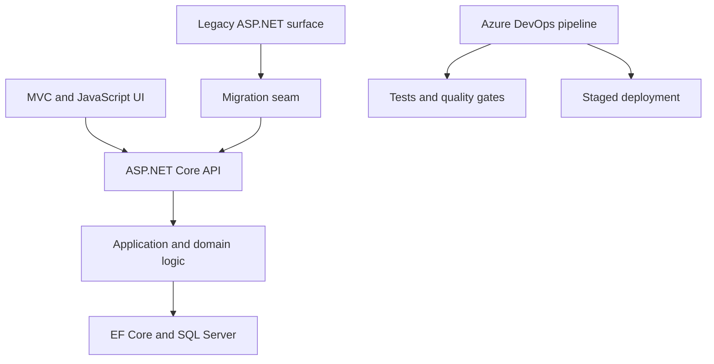
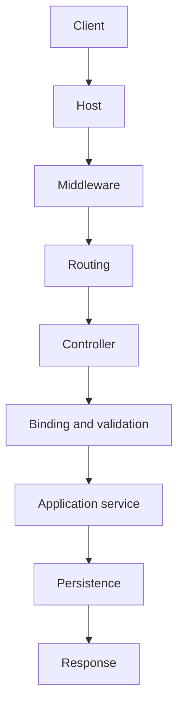
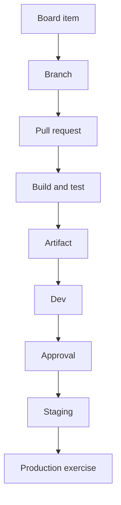

# The Gauntlet IV — Microsoft Enterprise Developer

**Modules M60–M71**  
**Target role:** Senior Developer in a Microsoft-heavy enterprise environment  
**Primary stack:** C#, .NET 10, ASP.NET Core MVC/Web API, Entity Framework Core, SQL Server, automated testing, Azure DevOps  
**Brownfield literacy:** ASP.NET Framework, VB.NET, jQuery, Knockout.js, AngularJS, JSON/XML

> The goal is not to become a junior .NET developer from scratch. It is to translate existing senior Java/enterprise engineering experience into Microsoft vocabulary and tooling, build enough with your own hands to reason rather than bluff, and become credible in both modern and brownfield .NET systems.

As of September 2026, .NET 10 is the active LTS release. Use it for new work while deliberately studying the older Microsoft estate implied by the job description. The role lists modern responsibilities beside ASP.NET, VB.NET, jQuery, Knockout, AngularJS, SQL Server, and XML; that is a modernization environment, not a greenfield-framework trivia contest.

---

## Read the role correctly

The company is not merely asking, “Can this person write C#?” It is asking whether you can:

- guide a medium-sized initiative without constant architectural supervision;
- understand an existing Microsoft application estate;
- design and deliver features across web, mobile, and internal systems;
- improve code without destabilizing production;
- mentor developers and raise code quality;
- reason about reuse without building an abstraction empire;
- communicate tradeoffs to developers, business leaders, and IT leadership;
- use Azure DevOps as part of the engineering system, not as a decorative pipeline screen.

Your risk is not that you lack all relevant experience. Your risk is that the interviewer hears “test automation pivot” and concludes that you no longer want to own application code. The whole gauntlet should demonstrate the opposite:

> Test automation was not an exit from software development. It broadened how I build software: I can design a feature, implement it, define its test seams, deliver it through CI/CD, and diagnose it in production. I am now translating that full-lifecycle experience into the .NET ecosystem.

Do not pretend the .NET gap is imaginary. Make it bounded and observable:

> My strongest production background is Java/Spring and TypeScript, so C# and the Microsoft application stack are the ecosystem gap I have been closing. The underlying work—OOP, web request lifecycles, database design, automated testing, CI/CD, modernization, and team delivery—is familiar. Here is the .NET system I built, the tradeoffs I made, and where the platforms differ.

---

## One capstone, not twelve disconnected demos

All modules feed one project: **Service Operations Hub**.

It manages service requests or work orders for an organization:

- staff submit requests;
- dispatchers prioritize and assign work;
- technicians update status and notes;
- supervisors see queues, aging, and SLA risk;
- a legacy internal page still performs one workflow;
- a modern ASP.NET Core application gradually takes ownership;
- data lives in SQL Server;
- builds, tests, artifacts, and deployments flow through Azure DevOps.

The domain is ordinary on purpose. Seniority should appear in the boundaries, failure handling, migration decisions, tests, delivery path, documentation, and team practices—not in an exotic product idea.

### Architecture target



Start as a modular monolith. A senior engineer does not earn extra credit for inventing distributed-systems problems before the domain requires them.

---

# M60 — Stop Writing Java in C#

**C# · .NET runtime · language translation · Medium · ~3 protected blocks**

## Story

You join a C# team Monday morning. Nobody needs you to relearn loops, inheritance, or interfaces. They need you to stop mentally transliterating Java and begin recognizing idiomatic C#.

Implement the domain engine without a web framework:

**work orders → technicians → assignments → status transitions → calculated priority**

## Ground Floor — The SDK, the CLR, and C#'s own idioms

*Read this before the rest of the module. It assumes Java fluency and M38's Ground Floor, so you've run a minimal API and met properties, records, and `Task`. It doesn't assume you can predict what C# copies, what it compares, what it allows to be null, or when a query runs. You'll build a throwaway room-bookings library first, outside any web framework. This tells you what each piece is for and what to look up, never how to write it. The work-order domain, its types, transition rules, and the async repository are the module's.*

### GF.1 — The picture first

```
a solution (.sln)
 ├─ Bookings.Domain   class library  ──▶  Bookings.Domain.dll  (an ASSEMBLY of IL)
 ├─ Bookings.Cli      console app    ──references──▶ Domain
 └─ Bookings.Tests    xUnit project  ──references──▶ Domain

dotnet build ─▶ C# compiler ─▶ IL in assemblies ─▶ at run time, the CLR JIT-compiles IL to machine code
NuGet packages ─▶ more assemblies, restored into the build
```

Same shape as a multi-module Maven build, with different words on every box.

### GF.2 — A solution, not a file

**Look up:** `dotnet new sln`, `classlib`, `console`, and `xunit`; `dotnet sln add` and `dotnet add reference`; `dotnet test`; the `<Nullable>`, `<ImplicitUsings>`, and `<TreatWarningsAsErrors>` properties in a `.csproj`; and `Directory.Build.props`, as a name.

**Do:** create the three projects above, wire the references, and make the console print something that lives in the library.

**Question to settle:** an assembly, a NuGet package, and a JAR. Which two are closest, and where does the analogy break?

### GF.3 — Value or reference, by experiment

**Look up:** value types vs reference types; what assignment copies for each; `struct`, `readonly struct`, `record` (a class), and `record struct`; `with` expressions; and how `==` and `Equals` behave for each.

**Do:** define a two-field `RoomSlot` (room, start time) four ways: class, struct, record, and record struct. For each, assign it to a second variable, change the copy where the type allows it, compare the two with `==` and `Equals`, and put two equal instances in a `HashSet`. Record the results in a table.

Don't decide which shape any work-order type should take. That's the module.

### GF.4 — Null, said out loud

**Look up:** nullable reference types; the `?` annotation; the `!` null-forgiving operator; `required` members; and the difference between a nullable warning and a compile error.

**Do:** turn `<Nullable>` off, write a small Java-style class with fields that may be unset, then turn it on and count the warnings. Silence one with `!` and write one sentence about what you just promised the compiler.

### GF.5 — LINQ past the first hour

**Look up:** M38's Ground Floor on deferred execution, then `IEnumerable<T>` vs `IQueryable<T>` (expression trees, as a name); materializing with `ToList` and `ToArray`; `First` vs `FirstOrDefault` vs `Single`; and `OrderBy(...).ThenBy(...)` and `GroupBy`.

**Do:** over a `List` of bookings, define a query for one room's bookings. Before enumerating it, add a matching booking to the source list. Then enumerate and explain what you got.

### GF.6 — Tasks and cancellation

**Look up:** `Task` and `Task<T>`; an `async Main`; `CancellationToken` and `CancellationTokenSource.CancelAfter`; `Task.Delay`; `OperationCanceledException`; and `ConfigureAwait` and `IAsyncEnumerable<T>`, as names.

**Build:** a method that "loads" bookings after a `Task.Delay` and honors a cancellation token, and a console that cancels it after a short time. Print the exception type you catch.

### GF.7 — Disposal

**Look up:** `IDisposable`; the `using` statement vs the `using` declaration; and `IAsyncDisposable`.

**Do:** write a class whose `Dispose` prints a line. Use it with each form of `using` and note exactly when the line appears. Compare it with Java's try-with-resources.

### GF.8 — Run it and observe

**Notice and leave alone:**

1. **Your four-way table from GF.3.** Which version let a slot be changed behind your back, or compared as unequal when it looked equal? That's M60's first decision.
2. **Two bookings for the same room at the same time.** Are they the same booking? What in your types said so? That's the second decision.
3. **Give one record a settable property,** use it as a dictionary key, change the property, and look the key up again. That's the third decision.
4. **Your fake async load.** What did `async` actually buy you in a method whose only wait is `Task.Delay`? That's the fourth decision.
5. **Your query that saw a late booking.** Where would that surprise cost you a second database trip or a double count? That's the fifth decision.
6. **The `!` you wrote.** That's the sixth decision.

### GF.9 — Hand-off: what's yours in M60

| Ground Floor left this… | M60 asks you to… |
|---|---|
| Room bookings in a throwaway library | Work orders, technicians, assignments, status transitions, and priority |
| One type written four ways | Choose class, record, record struct, struct, or enum for each domain type |
| Equality you observed | Decide which objects have identity and which are values |
| A mutable key that got lost | Decide where mutability is allowed |
| A fake async load | One async repository interface with cancellation, and what `async` means there |
| A query that saw a late change | LINQ where it clarifies, materialized where it must be |
| A `!` that silenced a warning | Nullable reference types on, knowing what they can't prove |
| No rules about bookings | Explicit transition rules, with tests for legal and illegal changes |

Then read the rest of the module below.

### GF.10 — Check yourself before moving on

- What's the difference between an assembly and a NuGet package?
- What happens when you assign a struct to a new variable and change the copy?
- What does a record class generate that a plain class doesn't?
- When does a LINQ query over a `List` actually run?
- What does `!` promise, and who checks the promise?

## Concept translation

| You already know | Learn the .NET expression |
|---|---|
| JVM | CLR |
| Java bytecode | CIL/IL |
| JAR/dependency ecosystem | assemblies and NuGet |
| POJO | C# class or record |
| Stream API | LINQ |
| `CompletableFuture` | `Task` and `async`/`await` |
| try-with-resources | `using` and `IDisposable` |
| Spring dependency injection | built-in .NET dependency injection |
| annotations | attributes |
| getters/setters | properties |
| `Optional` and null discipline | nullable reference types |

## Trap

Writing Java with different punctuation that happens to compile as C#.

## Decisions

Before implementation, answer:

1. When should a domain type be a `class`, `record`, `record struct`, `struct`, or enum?
2. Which objects have identity and which merely represent values?
3. Where is mutability allowed?
4. What does `async` actually mean in this operation?
5. Where does LINQ improve clarity, and where would it hide work or repeated enumeration?
6. What does nullable-reference analysis prevent, and what can it not prove?

## Research targets and stops

**Object model — 25 minutes**  
Stop when you can explain record versus class versus struct without saying merely “records are shorter.”

**LINQ — 25 minutes**  
Stop when you can demonstrate deferred execution, materialization, multiple enumeration, and the difference between `IEnumerable<T>` and `IQueryable<T>`.

**Async and Task — 45 minutes**  
Stop when you can distinguish asynchronous I/O, parallel execution, threads, and Tasks. Do not study every synchronization primitive.

## Build

- immutable `WorkOrderId` and value types;
- explicit status-transition rules;
- priority calculation from age, severity, and customer impact;
- LINQ queries over in-memory collections;
- one asynchronous repository interface with cancellation support;
- nullable reference types enabled;
- unit tests for legal and illegal state changes.

## Measure

Given unfamiliar C# code, predict:

- what allocates;
- what mutates;
- what can be null;
- what executes lazily;
- what asynchronous boundary exists;
- what is disposed and when.

## Prove it in three rooms

**Interview:** “Coming from Java, these are the C# differences that changed my design rather than merely its syntax.”  
**Code review:** Identify and improve one piece of Java-shaped C#.  
**Meetup:** Explain LINQ deferred execution in 30 seconds.

---

# M61 — Follow One HTTP Request All the Way Down

**ASP.NET Core · MVC · REST · dependency injection · middleware · Large · ~4 blocks**

## Story

Build one business operation:

> A staff member submits a service request. The server binds and validates it. Business rules determine its initial state. It is persisted. A REST response is returned. An internal MVC page can display it.

One operation. Trace it completely.

## Ground Floor — The host, the pipeline, and the controller

*Read this before the rest of the module. It assumes M60's Ground Floor, M38's minimal API, and Spring from M1, but not that you've written controllers, ordered middleware, or rendered an MVC view in ASP.NET Core. You'll build a throwaway room-bookings API and one list page first. This tells you what each piece is for and what to look up, never how to write it. Where rules live, DTOs, lifetimes, validation, the error contract, and cancellation are the module's.*

### GF.1 — The picture first

```
socket ─▶ Kestrel ─▶ MIDDLEWARE, in the order you added it:
                       exception handler ─▶ logging ─▶ routing ─▶ auth ─▶ endpoint
                       (each one can call next, or SHORT-CIRCUIT and answer itself)
                                                                      │
                                         endpoint = a controller ACTION
                                           ├─ MODEL BINDING   route, query, body → parameters
                                           ├─ VALIDATION      attributes, ModelState
                                           └─ your code ─▶ a result ─▶ serialized response
◀────────────────────────────── the same middleware, unwinding in reverse ───────────
```

### GF.2 — The host and Program.cs

**Look up:** `WebApplication.CreateBuilder`; the split between `builder.Services` (registration) and `app.Use…`/`app.Map…` (the pipeline); environments (`Development`, `Production`); and `appsettings.json`, `appsettings.Development.json`, and `launchSettings.json`.

**Do:** run `dotnet new webapi --use-controllers` and read every line of `Program.cs`. For each line, write which half it belongs to.

### GF.3 — Middleware, by hand

**Look up:** `app.Use` with a `next` delegate, `app.Run`, ordering, and short-circuiting; and the built-in exception handler, routing, static files, and authorization middleware.

**Do:** add two inline middleware that log "before" and "after" around `next`. Swap their order and compare the logs. Add a third that answers one path itself without calling `next`.

**Question to settle:** which Spring piece is middleware closest to: a servlet filter, an interceptor, or neither?

### GF.4 — Controllers, routing, and binding

**Look up:** `[ApiController]` and `ControllerBase`; attribute routing; `[FromBody]`, `[FromRoute]`, and `[FromQuery]`, and how `[ApiController]` infers them; `ActionResult<T>` and `CreatedAtAction`; and data annotations such as `[Required]` and `[Range]`.

**Build:** `POST /api/bookings` and `GET /api/bookings/{id}` over an in-memory list. Use the simplest code that works.

### GF.5 — What ASP.NET says when things go wrong

**Look up:** problem details (RFC 9457, which replaced RFC 7807); `AddProblemDetails`; `UseExceptionHandler`; and `ValidationProblemDetails`.

**Do:** send malformed JSON, a body missing a required field, an id that doesn't exist, and make one action throw. Record the status code and body of each. Don't unify them.

### GF.6 — An MVC page

**Look up:** `AddControllersWithViews`; Razor views (`.cshtml`), `_Layout`, and view models; and tag helpers, as a name.

**Build:** a page that lists bookings.

**Question to settle:** the API and the page both need bookings. Where should the code they share live?

### GF.7 — Lifetimes and logs

**Look up:** `AddSingleton`, `AddScoped`, and `AddTransient` (M38's Ground Floor named them); `ILogger<T>` and message templates; `HttpContext.TraceIdentifier`; and `HttpContext.RequestAborted`.

**Do:** register a service that counts how many times its constructor runs. Register it under each lifetime in turn, hit an endpoint three times, and compare the counts.

### GF.8 — Run it and observe

**Notice and leave alone:**

1. **Your swapped middleware.** What did you put in middleware that only one route needs, or in an action that every route needs? That's M61's first decision.
2. **"A room can't be double-booked."** If you wrote that rule, where did it land? In the action? That's the second decision.
3. **The object your POST binds is the one you store and return.** Add an internal field and look at the JSON. That's the third decision.
4. **Inject your scoped counter into a singleton.** Does the app start in Development? In Production? That's the fourth decision.
5. **Put a `[Range]` on a field, then add a rule that needs the database.** Where does each kind of check go? That's the fifth decision.
6. **Your four failure bodies.** Do any two look alike? Which ones are problem details? That's the sixth decision.
7. **Add a long `Task.Delay` to one action and abort the curl.** Did the action notice? That's the seventh decision.

### GF.9 — Hand-off: what's yours in M61

| Ground Floor left this… | M61 asks you to… |
|---|---|
| A bookings API in memory | `POST` and `GET /api/work-orders`, plus an MVC list and detail page |
| Middleware you swapped for fun | Decide what belongs in middleware and what in a controller |
| A rule wherever it landed | Keep business rules out of the controller |
| One object to bind, store, and return | Request and response DTOs distinct from persistence entities |
| Lifetimes picked to count instances | Choose every lifetime deliberately, with registration kept visible |
| Annotations and automatic 400s | Split structural validation from business rules |
| Four different failure bodies | Centralized problem details and a predictable contract |
| An aborted request nobody noticed | Decide where cancellation tokens flow |
| Plain log lines | Correlation IDs, structured request logging, and OpenAPI |

Then read the rest of the module below.

### GF.10 — Check yourself before moving on

- Name the stages between Kestrel and your action, in order.
- What does short-circuiting mean in the middleware pipeline?
- When does `[ApiController]` return a 400 before your action runs?
- How many instances of a scoped service did three requests create?
- Where does the middleware-vs-Spring-filter analogy break?

## Trap

Learning ASP.NET by memorizing controller attributes.

## Runtime walk

Be able to draw and narrate:



## Decisions

1. What belongs in middleware rather than a controller?
2. What belongs in a controller rather than the domain/application layer?
3. Are request DTOs the same objects as persistence entities? Why or why not?
4. Which dependencies are singleton, scoped, or transient?
5. Where is validation structural, and where is it a business rule?
6. What status codes and error representation make the contract predictable?
7. Where should cancellation tokens flow?

## Research targets and stops

**Hosting and middleware — 35 minutes**  
Stop when you can predict the effect of middleware order and explain short-circuiting.

**Routing, binding, validation — 35 minutes**  
Stop after deliberately causing binding failure, validation failure, business-rule failure, and an unhandled exception—and observing the different responses.

**Dependency injection lifetimes — 25 minutes**  
Stop when you can explain why injecting a scoped dependency into a singleton is dangerous.

## Build

- `POST /api/work-orders`;
- `GET /api/work-orders/{id}`;
- an MVC list/detail page;
- request and response DTOs distinct from persistence entities;
- centralized problem-details responses;
- correlation ID and structured request logging;
- OpenAPI documentation;
- dependency registration kept visible and intentional.

## Measure

For one request, account for every transition from socket-facing host to database and back. No “then ASP.NET does stuff.”

## Prove it in three rooms

**Interview:** Compare ASP.NET Core's middleware/request model with Spring Boot filters, interceptors, controllers, validation, and DI.  
**Design review:** Defend why business rules do not live in the controller.  
**Incident room:** Locate whether a failure occurred in binding, domain logic, persistence, or response generation.

---

# M62 — Make SQL Server an Explicit Design Partner

**Entity Framework Core · SQL Server · schema design · transactions · concurrency · Large · ~4 blocks**

## Story

Two dispatchers open the same work order. One reassigns it while the other closes it from stale data. Your ORM does not remove the concurrency problem; it merely gives you tools to express a policy.

## Ground Floor — SQL Server on its own, then EF Core on top

*Read this before the rest of the module. It assumes M61's Ground Floor, Postgres from M2's, and the persistence context from M51's, but not that you've run SQL Server or used Entity Framework Core. You'll put throwaway rooms and bookings in SQL Server by hand first, then through EF Core. This tells you what each piece is for and what to look up, never how to write it. Invariants, concurrency, transactions, loading strategy, tracking, migrations in delivery, and indexes are the module's.*

### GF.1 — The picture first

```
WRITES:  your code changes objects ─▶ CHANGE TRACKER notices ─▶ SaveChanges ─▶ SQL ─▶ SQL Server
READS:   LINQ ─▶ expression tree ─▶ PROVIDER translates ─▶ SQL ─▶ rows ─▶ objects (tracked, unless told not to)
SCHEMA:  your model ─▶ migration (C#) ─▶ migration SQL ─▶ tables
```

The `DbContext` is M51's persistence context, wearing a .NET name.

### GF.2 — SQL Server in a container

**Look up:** the SQL Server Linux container image and its required environment variables; `sqlcmd` (the newer Go version is easiest); a GUI client (Azure Data Studio or SSMS on the Windows side); and the T-SQL details that differ from Postgres: `IDENTITY`, `OFFSET … FETCH`, `NVARCHAR`, `datetime2`, and the `dbo` schema.

**Do:** run it, create `Rooms` and `Bookings` by hand, insert a few rows, and query bookings with their room names.

### GF.3 — EF Core mapping

**Look up:** `DbContext` and `DbSet<T>`; conventions vs the fluent API in `OnModelCreating` vs attributes; keys and navigation properties; the SQL Server provider; and the `dotnet ef` tool: `migrations add`, `database update`, and `migrations script`.

**Build:** map `Room` and `Booking` in a fresh database, add an initial migration, read the generated migration and its SQL script, and apply it.

### GF.4 — The change tracker

**Look up:** entity states (Added, Modified, Unchanged, Deleted, Detached); `ChangeTracker.DebugView`; `AsNoTracking`; and why a `DbContext` is registered as scoped in ASP.NET Core.

**Do:** load a booking, change one property, print `DebugView`, call `SaveChanges`, and read the SQL that ran.

### GF.5 — Seeing every statement

**Look up:** `LogTo` and `EnableSensitiveDataLogging`; `ToQueryString()`; `Include`; projection with `Select`; and lazy-loading proxies, as a name.

**Do:** list bookings with their room names three ways: with `Include`, without `Include` while touching each booking's room, and with a `Select` projection. Count the statements each one sends.

### GF.6 — Reading a plan

**Look up:** estimated vs actual execution plans; `SET STATISTICS IO ON`; clustered vs nonclustered indexes; seeks vs scans; and Query Store, as a name.

**Do:** seed a few thousand bookings, filter by room and date, and read the actual plan.

### GF.7 — Two contexts, one row

**Look up:** `DbUpdateConcurrencyException`, as a name.

**Do:** in a console, load the same booking in two separate `DbContext` instances. Change a different property in each, then save both. Read the row.

### GF.8 — Run it and observe

**Notice and leave alone:**

1. **Try to save a booking that ends before it starts,** through EF Core and then through `sqlcmd`. Which layer refused it, if any? That's M62's first decision.
2. **Your two contexts.** Whose change survived, and did anything tell you? That's M62's story. Where the fix is enforced is the second decision.
3. **Your three ways to load a list.** Compare the statement counts. That's the fifth decision.
4. **`DebugView` after a list you only meant to display.** What was tracked? That's the sixth decision.
5. **Who ran `database update`, against which database, from which machine?** Now picture staging. That's the seventh decision.
6. **Your plan: a seek or a scan?** Don't add an index yet. That's the eighth decision.

### GF.9 — Hand-off: what's yours in M62

| Ground Floor left this… | M62 asks you to… |
|---|---|
| Rooms and bookings | Work orders, assignments, notes, and a paginated supervisor queue |
| Tables by hand, then by migration | Reproducible SQL Server, mappings, and migrations from an empty database |
| Whatever refused a bad booking | Decide which invariants live in code, the database, or both |
| A silent lost update | An explicit concurrency token and a conflict policy |
| Default relationships | Decide required, optional, owned, and many-to-many relationships |
| Three ways to load a list | Projection into read models, with a loading strategy you chose |
| Tracking everywhere | Decide when queries are no-tracking |
| `database update` from your laptop | Decide who applies migrations, and when |
| A plan read, no index added | Indexes justified by observed queries |
| No transaction thought | One meaningful multi-record transaction, and one query in ADO.NET |

Then read the rest of the module below.

### GF.10 — Check yourself before moving on

- What does a `DbContext` track, and how long should one live in a web app?
- How did you see the SQL EF Core sent?
- What's the difference in SQL between `Include` and a `Select` projection?
- What happened when two contexts saved the same row?
- Seek or scan: what did your plan show, and why?

## Trap

Treating Entity Framework Core as a spell that converts classes into a correct database.

## Decisions

1. Which invariants belong in domain code, database constraints, or both?
2. Where should optimistic concurrency be enforced?
3. When is one `SaveChanges` call enough, and when is an explicit transaction justified?
4. Which relationships are required, optional, owned, or many-to-many?
5. What should be eagerly loaded, explicitly loaded, projected, or left untouched?
6. When should a query be no-tracking?
7. Who applies migrations, and at what point in delivery?
8. Which indexes support observed query patterns rather than imagined scale?

## Research targets and stops

**EF Core mapping and change tracking — 45 minutes**  
Stop when you can explain what the change tracker knows, why tracked entities can become stale, and when projection is preferable.

**SQL Server execution reality — 45 minutes**  
Inspect generated SQL and an execution plan. Stop when you can identify one avoidable N+1/query-shape problem and one useful index.

**Transactions and concurrency — 45 minutes**  
Stop when you can reproduce and handle an optimistic concurrency conflict.

## Build

- SQL Server in a reproducible local environment;
- EF Core mappings and migrations;
- constraints for required states and uniqueness;
- `rowversion` or another explicit concurrency token;
- paginated, filtered supervisor queue;
- projection directly into read models;
- one transaction spanning a meaningful multi-record operation;
- seed data that creates realistic query sizes and conflict cases;
- a short data dictionary.

Then implement one query with lower-level SQL or ADO.NET—not because EF is bad, but so you understand the boundary beneath it.

## Measure

Capture:

- query count for the supervisor page;
- query duration for a representative dataset;
- behavior during a concurrency conflict;
- migration from an empty database;
- rollback/recovery plan for a failed schema change.

## Prove it in three rooms

**Interview:** Explain why ORM fluency includes SQL fluency.  
**Code review:** Spot accidental client-side evaluation, over-fetching, or repeated enumeration.  
**Production review:** Explain how you would release a schema change without assuming application and database deploy atomically.

---

# M63 — Test the System, Not Your Mock Collection

**xUnit · test doubles · integration tests · contract tests · UI tests · Large · ~4 blocks**

## Story

The role that previously made interviewers wonder whether you wanted to “pivot” into test automation is now where you demonstrate fuller engineering ownership.

Testing is not a separate identity. It is how you prove the application you designed behaves under change.

## Ground Floor — The .NET test stack, one layer at a time

*Read this before the rest of the module. It assumes your test-automation background and M61–M62's Ground Floors, but not that you've used xUnit, hosted ASP.NET Core inside a test, or started SQL Server from one. You'll test the throwaway bookings API at each layer first. This tells you what each piece is for and what to look up, never how to write it. Which risk goes in which layer, the contract, the UI suite, flake policy, and fault injection are the module's.*

### GF.1 — The picture first

```
                         what's REAL in the test
unit          domain rule only
host          routing, binding, validation, serialization, middleware   (in memory, no socket)
database      + SQL Server's constraints and query behavior               (a container)
contract      + the agreed shape between two services
UI            + a browser, the page, and everything under it

faster ◀──────────────────────────────────────────────────────────▶ more real
```

Each layer catches what the layers above it fake.

### GF.2 — xUnit's shape

**Look up:** `[Fact]` and `[Theory]` with `[InlineData]` and `[MemberData]`; why xUnit creates a new class instance per test (constructor and `IDisposable` instead of setup and teardown attributes); `IClassFixture<T>` and `ICollectionFixture<T>`; and test parallelization by collection. Compare each with JUnit 5.

**Do:** add a throwaway rule that a booking can't end before it starts, and test it with one theory.

### GF.3 — The real host, in memory

**Look up:** `WebApplicationFactory<TProgram>` from `Microsoft.AspNetCore.Mvc.Testing`; why `Program` may need to be visible to the test project; and `ConfigureWebHost` with `ConfigureTestServices` for replacing a registration.

**Build:** a test that posts a booking through the factory's `HttpClient` and reads it back.

### GF.4 — A real database per run

**Look up:** Testcontainers for .NET and its SQL Server module; applying EF Core migrations in a fixture; and Respawn, as a name, for resetting data between tests.

**Build:** one test that saves a booking against a container.

### GF.5 — Doubles, by name and by need

**Look up:** the test-double vocabulary (dummy, stub, fake, spy, mock) and Fowler's "Mocks Aren't Stubs"; and one mocking library, Moq or NSubstitute, just enough to use it.

**Do:** in your host test, replace a clock or a notification service twice: once with a hand-written fake, once with a library mock. Compare what each test can assert.

### GF.6 — Contracts and browsers, by name

**Look up:** consumer-driven contract testing and PactNet; Playwright for .NET and its browser install step; and the difference between a smoke test and a full end-to-end regression suite.

**Do:** run one Playwright test that opens your bookings page and finds one row.

### GF.7 — Run it and observe

**Notice and leave alone:**

1. **Write a test that mocks the repository and verifies `Save` was called.** Now rename a JSON property in the response DTO. Does that test fail? Does the host test? That's M63's trap.
2. **Time your unit test and your host test.** What did the host test exercise that the unit test couldn't? That's the second decision.
3. **Swap the container for EF Core's in-memory provider** in a throwaway test, and insert a row that breaks a unique constraint. Did it fail? That's the third decision.
4. **Your fake and your mock from GF.5.** Which test survives a refactor of the service's internals? That's the fourth decision.
5. **Run the Playwright test ten times with the network throttled.** Did it ever fail? What should your team do when it does? That's the seventh decision.

### GF.8 — Hand-off: what's yours in M63

| Ground Floor left this… | M63 asks you to… |
|---|---|
| One rule, one theory | xUnit domain tests that make unit tests the cheapest proof |
| A host test for bookings | API integration tests using the real ASP.NET Core host |
| One container test | Database tests against a disposable SQL Server environment |
| A fake and a mock, compared | Decide where a fake fits and where mocking erases the thing tested |
| PactNet read about | One consumer/provider contract around a fake notification service |
| One Playwright test | A smoke suite for the highest-value workflow, and a decision on what stays out of UI tests |
| A throttled run that flaked, or didn't | The team's response to a flaky test |
| Tests that print to your terminal | Builders that reveal intent, failure output published by the pipeline, and fault injection on one rule |

Then read the rest of the module below.

### GF.9 — Check yourself before moving on

- What's per-test in xUnit, and what's shared through a fixture?
- What does `WebApplicationFactory` exercise that calling a controller method doesn't?
- What did EF Core's in-memory provider fail to catch?
- Stub or mock: what does each one let a test assert?
- How long did each layer of your suite take?

## Trap

Producing a beautiful coverage percentage over tests that verify mock interactions and never exercise routing, serialization, SQL Server behavior, or browser workflows.

## Decisions

1. Which behavior is cheapest to prove as a unit test?
2. Which risks require the real ASP.NET host?
3. Which database behaviors require a real SQL Server-compatible environment?
4. Where is a fake appropriate, and where does mocking erase the thing being tested?
5. Which external boundary deserves a contract test?
6. What belongs in UI automation, and what becomes brittle there?
7. What is the team's response to a flaky test?

## Build

- xUnit domain tests;
- API integration tests using the real ASP.NET Core application host;
- database integration tests against a disposable database environment;
- one consumer/provider contract around a fake notification service;
- a small Playwright or Selenium smoke suite for the highest-value workflow;
- test data builders/fixtures that reveal intent;
- failure output published by the pipeline;
- mutation or fault injection against one important rule.

## Research stop

Stop comparing mocking frameworks after you can create, configure, and verify the one test double the project actually needs. Framework trivia is not the objective.

## Measure

For every test suite, state:

- what risk it covers;
- which real components it exercises;
- what defect it would miss;
- how long it takes;
- who owns a failure.

The key number is not maximum coverage. It is whether a change to a state-transition rule, HTTP contract, or SQL constraint fails in the most informative layer.

## Prove it in three rooms

**Interview:** “My test automation experience makes me better at application design because I recognize seams, contracts, failure modes, and delivery risk. I still own implementation.”  
**Code review:** Replace an implementation-coupled test with a behavior-focused test.  
**Pipeline incident:** Triage a failure as product regression, test defect, environmental failure, or intermittent system behavior.

---

# M64 — Read the Brownfield Microsoft Estate

**.NET Framework · ASP.NET MVC/Web Forms awareness · VB.NET · jQuery · Knockout.js · AngularJS · XML · Large · ~4 blocks**

## Story

You inherit an internal application that still works and makes money. Some pages use server-rendered ASP.NET, some use jQuery, one uses Knockout, another uses AngularJS, and part of the business layer is VB.NET. An XML integration predates the current team.

Your task is not to sneer at it. Your task is to map it, make a safe change, and propose a credible migration seam.

## Ground Floor — Reading code from three generations

*Read this before the rest of the module. It assumes C#, ASP.NET Core from M61's Ground Floor, and plenty of JavaScript, but not that you've read .NET Framework code, VB.NET, jQuery, Knockout, or an XSD. You'll read one public legacy project and build tiny throwaway pieces in each older technology first. This tells you what each piece is for and what to look up, never how to write it. The legacy companion, its inventory, its tests, and what to leave, wrap, extract, or replace are the module's.*

### GF.1 — The picture first

```
SERVER, by generation                         ONE BROWSER PAGE, by generation
.NET Framework 4.x   System.Web, IIS,         server-rendered HTML
                     web.config, Global.asax    ├─ jQuery handlers      edit the DOM directly
.NET Standard 2.0    the bridge library         ├─ a Knockout view model  binds some of the DOM
.NET 10              ASP.NET Core, Kestrel      └─ an AngularJS controller owns another part
VB.NET and C#        both compile to the same IL
```

Every box still works. The question is who owns what.

### GF.2 — .NET Framework vs modern .NET, as ideas

**Look up:** .NET Framework 4.8 (Windows-only, installed with the OS); .NET Standard 2.0; SDK-style vs legacy `.csproj` files; `packages.config` vs `PackageReference`; `System.Web` and why ASP.NET Core doesn't have it; `Global.asax`; and `web.config` transforms.

**Do:** pick an open-source ASP.NET MVC 5 or Web Forms project on GitHub. Read its project file and `web.config`, and list every `System.Web` dependency you can find. Read only; you don't need Windows for this.

### GF.3 — VB.NET, the first hour

**Look up:** VB.NET for a C# reader: `Dim … As`, `Sub` vs `Function`, `Nothing`, case-insensitivity, `Option Strict`, `Option Explicit`, and `Option Infer`, and `AndAlso`/`OrElse` vs `And`/`Or`.

**Build:** `dotnet new classlib -lang VB` with one function that calculates a room-booking fee, called from a C# xUnit test.

**Question to settle:** `And` vs `AndAlso`. If the right-hand side has a side effect, which one runs it?

### GF.4 — jQuery and Knockout, enough to trace

**Look up:** jQuery selectors, `.on` and event delegation, and `$.ajax`; Knockout observables, `data-bind`, `ko.applyBindings`, and computed observables; and AngularJS's `ng-controller` and `$scope`, as names.

**Build:** one static page with a bookings list loaded by `$.ajax` and a Knockout-bound count of selected rows.

### GF.5 — XML contracts

**Look up:** XML namespaces; XSD elements, types, `minOccurs`, and `sequence`; validating against an XSD in .NET (`XmlSchemaSet`, `XmlReaderSettings`); and `XmlSerializer` vs LINQ to XML.

**Do:** write an XSD for a small booking export, then validate one good file and one bad file against it.

### GF.6 — Characterization tests

**Look up:** Michael Feathers' characterization tests; golden-master or approval testing; and Verify for .NET, as a name.

**Do:** pin the VB fee function's current output for ten inputs, including one result you think is wrong. Leave it pinned.

### GF.7 — Run it and observe

**Notice and leave alone:**

1. **Your `System.Web` list.** Which items carry business logic, and which are plumbing? That's M64's first decision, and the second.
2. **Your VB library.** Which framework does it target, and could it target two? That's the third decision.
3. **Picture changing one behavior in the project you read:** inside its page, behind an adapter, or on a new route. Which feels safest, and why? That's the fourth decision.
4. **Reorder two elements in your valid XML file.** Does the XSD still accept it? Would a consumer that reads by position? That's the fifth decision.
5. **Change the list with jQuery directly.** Does Knockout's count agree? That's the sixth decision.
6. **The wrong-looking value you pinned.** Fix it or keep it? Who might depend on it? That's the trap.

### GF.8 — Hand-off: what's yours in M64

| Ground Floor left this… | M64 asks you to… |
|---|---|
| A public legacy project, read | A small legacy companion workflow of your own |
| A `System.Web` list | A dependency and runtime inventory, portable vs framework-specific |
| One VB function, one C# test | A VB.NET business-rule library you can call, test, and trace |
| One jQuery + Knockout page | One legacy screen whose DOM ownership you can explain |
| An XSD and two files | An XML contract that "cleanup" can't break |
| One pinned function | Characterization tests before every behavior change |
| A safest-change guess | Decide in place, behind an adapter, or on a new route |
| Opinions about old code | An ADR choosing what to leave, wrap, extract, or replace, and what evidence a rewrite needs |

Then read the rest of the module below.

### GF.9 — Check yourself before moving on

- What's the difference between .NET Framework, .NET Standard, and .NET 10?
- Why can't ASP.NET Core use a library that depends on `System.Web`?
- `And` vs `AndAlso` in VB.NET: what's different?
- In your Knockout page, where does the truth for the bound count live?
- What does a characterization test assert, and why might it pin a bug?

## Trap

Calling the old system “legacy” as though that alone proves it should be rewritten.

## First artifact: the estate map

| Concern | Existing implementation | Risk | Test seam | Candidate future home |
|---|---|---|---|---|
| Request/route | ASP.NET Framework |  |  | ASP.NET Core |
| View behavior | jQuery/Knockout/AngularJS |  |  | server view or chosen modern client |
| Business rule | C# or VB.NET library |  |  | portable domain/application library |
| Data access | ADO.NET/older ORM/stored procedure |  |  | retained or EF Core behind boundary |
| Integration | XML |  |  | versioned adapter/contract |

## Decisions

1. What is .NET Framework-specific versus portable business logic?
2. What uses `System.Web`, session, global state, or framework-specific authentication?
3. Can a library multi-target, be isolated behind an interface, or be left alone?
4. Is the safest first change in place, behind an adapter, or in a new route?
5. What protects the XML contract from “cleanup” that breaks a consumer?
6. Which UI framework owns each piece of DOM state?
7. What evidence would justify rewrite rather than incremental migration?

## Build

Create a deliberately small legacy companion:

- one .NET Framework-style or carefully simulated legacy workflow;
- one VB.NET business-rule library that you can call and test;
- one jQuery or Knockout screen;
- one XML import/export contract with XSD or explicit validation rules;
- characterization tests before changing behavior;
- a dependency and runtime inventory;
- an architecture decision record choosing what to leave, wrap, extract, or replace.

Do not spend weeks becoming an AngularJS or Knockout specialist. Learn enough to trace state, events, bindings, network calls, and teardown.

## Measure

Make one behavior change while preserving:

- route compatibility;
- payload or XML contract compatibility;
- existing test behavior;
- rollback capability;
- a written explanation of blast radius.

## Prove it in three rooms

**Interview:** Explain how Java/C++ modernization work prepared you to work respectfully inside an older Microsoft estate.  
**Design review:** Defend one component you chose not to rewrite.  
**Mentoring:** Show a junior developer how to trace data through a page with several generations of JavaScript without guessing.

---

# M65 — Modernize by Seams, Not by Hope

**incremental migration · strangler pattern · compatibility · feature flags · Large · ~4 blocks**

## Story

The team cannot stop feature delivery for a year-long rewrite. Move one workflow from the legacy application into ASP.NET Core while both remain operable.

Microsoft's migration guidance describes ASP.NET Framework-to-Core migration as nontrivial for most production applications and identifies incremental migration as the safer path for many large or dependency-heavy systems.

## Ground Floor — A proxy, a flag, and two apps behind one URL

*Read this before the rest of the module. It assumes M61's Ground Floor and M64's, but not that you've run a reverse proxy in .NET or routed traffic between two versions of an app. You'll put two throwaway bookings apps behind one proxy first, an "old" one with a quirk and a "new" one without it. This tells you what each piece is for and what to look up, never how to build the migration. The seam, data ownership, coherence, comparison, rollback, and retirement are the module's.*

### GF.1 — The picture first

```
browser ─▶ REVERSE PROXY (YARP) ─▶ route table ─┬─▶ OLD app   (everything, at first)
                                     ▲          └─▶ NEW app   (one path, when the flag says so)
                                     │
                               a FEATURE FLAG you can flip without redeploying

both apps ─▶ the same database?  ─▶ who owns which rows?
logs from both ─▶ one correlation id ─▶ compare answers
```

The user sees one URL. Behind it, ownership moves one path at a time.

### GF.2 — Strangler fig, as an idea

**Look up:** Martin Fowler's "Strangler Fig Application"; branch by abstraction; parallel run and shadow traffic; and Microsoft's incremental ASP.NET to ASP.NET Core migration guidance, including System.Web adapters, as names.

**Do:** write one paragraph on how a strangler fig differs from branch by abstraction.

### GF.3 — A proxy in front

**Look up:** YARP (`Yarp.ReverseProxy`); routes and clusters in configuration; path matching; and header transforms.

**Build:** two minimal bookings apps. The old one formats dates in an odd way; the new one doesn't. Put YARP in front, send everything to the old app, then route one path to the new one.

### GF.4 — A flag you can flip

**Look up:** `Microsoft.FeatureManagement`; flag filters (percentage, targeting), as names; and configuration that reloads without a restart.

**Build:** make which app answers your chosen path depend on a flag you can change without redeploying.

### GF.5 — Comparing two answers

**Look up:** dark launching; diffing JSON responses; and carrying a correlation ID across the proxy, as in M61.

**Do:** send the same 20 requests to each app directly and diff the responses. Write down every difference, including the quirk.

### GF.6 — Run it and observe

**Notice and leave alone:**

1. **Your route table.** You used a URL path as the seam. Could it have been a service, a shared library, or the database? That's M65's first decision.
2. **Both apps read the same bookings.** If both could write, who would own a row? That's the second decision.
3. **Set a cookie in the old app and follow a request through the proxy to the new one.** What came along, and what didn't? Do both log the same way? That's the third decision.
4. **Your diff list, and the quirk.** Preserve it or fix it? Who decides, and how will you prove the new app matches? That's the fourth decision, and the trap is right next to it.
5. **Flip the flag back while a user is mid-flow.** What did they see? That's the fifth decision.
6. **Your old route.** When could you delete it, and what would tell you? That's the sixth decision.

### GF.7 — Hand-off: what's yours in M65

| Ground Floor left this… | M65 asks you to… |
|---|---|
| Two toy apps behind YARP | One bounded workflow from M64 moving to ASP.NET Core, behind a visible seam |
| A path-based route | Choose the first stable seam |
| A shared database, by default | Decide data ownership while both apps run |
| Cookies and logs that may not cross | Coherent authentication, session, errors, logging, and configuration |
| A flag flipped by hand | Controlled routing, with the outward contract preserved |
| 20 requests diffed once | Comparison telemetry or shadow evaluation where it's safe |
| A flip back mid-flow | A documented rollback path |
| An old route still standing | Retire the old path only after proof, tracked in a migration ledger |

Then read the rest of the module below.

### GF.8 — Check yourself before moving on

- What's the strangler fig pattern, in two sentences?
- In YARP, what does a route match, and what does a cluster contain?
- Where did your flag's value come from, and how did it change without a redeploy?
- How many differences did your diff find?
- In your toy setup, what made a path "migrated": new code existing, or something more?

## Trap

Building a pristine replacement that cannot be released until it has reproduced ten years of accumulated behavior.

## Decisions

1. Where is the first stable seam: route, service, database access, event, or shared library?
2. Do old and new applications share a database temporarily? If so, what rules control ownership?
3. How are authentication, session, errors, logging, and configuration made coherent?
4. How do you compare new behavior with old behavior?
5. What is the rollback path?
6. When is a compatibility adapter temporary, and how will the team know it can be removed?

## Build

- select one bounded workflow from M64;
- characterize current behavior;
- route that workflow to the modern application through a visible seam;
- preserve the outward contract;
- use a feature flag or controlled routing decision;
- add comparison telemetry or shadow evaluation where safe;
- document rollback;
- delete or disable the old path only after proof.

## Measure

Maintain a migration ledger:

| Capability | Current owner | Future owner | Compatibility layer | Exit evidence |
|---|---|---|---|---|

No item is “migrated” merely because new code exists. It is migrated when traffic, ownership, operations, and rollback responsibility are clear.

## Prove it in three rooms

**Interview:** Contrast rewrite, in-place upgrade, and incremental migration.  
**Leadership review:** Explain the delivery/risk tradeoff in business language.  
**Incident room:** Roll traffic back without improvising.

---

# M66 — Make Azure DevOps the Delivery System

**Azure Repos · Boards · YAML Pipelines · artifacts · environments · quality gates · Large · ~4 blocks**

## Story

The application works locally. That is the beginning of the delivery problem, not the end.

Build a delivery path that another developer can understand and operate: work item to branch to pull request to test evidence to artifact to environment.

## Ground Floor — An organization, a pipeline, and one artifact

*Read this before the rest of the module. It assumes Jenkins or Spinnaker experience and the throwaway bookings app from M61–M63's Ground Floors, but not that you've set up Azure DevOps or written its YAML. You'll take the throwaway from a board item to a do-nothing deployment first. This tells you what each piece is for and what to look up, never how to build the real pipeline. Triggers, artifact promotion, configuration, agents, approvals, migrations, gates, and permissions are the module's.*

### GF.1 — The picture first

```
ORGANIZATION ─▶ PROJECT ─▶ Boards · Repos · Pipelines · Artifacts

a pipeline RUN:
  trigger ─▶ STAGE ─▶ JOB (gets an AGENT) ─▶ STEPS (scripts and tasks)
                                               └─▶ publish ARTIFACT
           ─▶ STAGE ─▶ DEPLOYMENT JOB ─▶ ENVIRONMENT (checks, approvals) ─▶ download the same artifact
```

### GF.2 — An organization and a project

**Look up:** creating a free Azure DevOps organization and project; free-tier parallel job limits, and the request new organizations may need to make before hosted agents run; and Boards process templates (Basic, Agile, Scrum).

**Do:** create the organization and project, and one Epic → Feature → User Story → Task chain for the throwaway.

### GF.3 — YAML from zero

**Look up:** the pipeline YAML schema: `trigger`, `pr`, `pool`, `stages`, `jobs`, and `steps`; `script` vs `task`; the `UseDotNet@2` and `DotNetCoreCLI@2` tasks; and predefined variables such as `Build.SourceBranch` and `Build.BuildId`.

**Build:** a one-stage pipeline that restores, builds, and runs the throwaway's unit tests on every push.

**Question to settle:** what are your Jenkins words for a stage, a job, an agent, and a task?

### GF.4 — Artifacts

**Look up:** publishing and downloading pipeline artifacts; `dotnet publish` output; and pipeline artifacts vs Azure Artifacts package feeds.

**Build:** publish the app as an artifact in stage one, and download it in stage two that only lists its files.

### GF.5 — Variables, secrets, and environments

**Look up:** variables, variable groups, and runtime parameters; secret variables and log masking; linking Azure Key Vault, as a name; service connections; and environments with checks and approvals.

**Do:** add a secret variable and echo it in a script step. Read the log. Then create an environment with a manual approval and target it from a deployment job that only prints a line.

### GF.6 — Branch policies

**Look up:** branch policies (required reviewers, build validation, linked work items) and pull-request templates.

**Do:** protect `main` with build validation and open one pull request against it.

### GF.7 — Run it and observe

**Notice and leave alone:**

1. **Your pipeline's runs.** Did it run on the push and again on the pull request? What should run when? That's M66's first decision.
2. **Stage two downloaded the artifact.** Picture staging rebuilding from source instead. What could differ? That's the second decision.
3. **The secret you echoed.** What did the log show? Where else could it leak, a config file inside the artifact? That's the third decision.
4. **Your first queued run.** How long did it wait for a hosted agent? That's the fourth decision.
5. **Your approval.** Is it in YAML or on the environment? Who could bypass each? That's the fifth decision, and the eighth.
6. **There's no database step yet.** Where would a migration run, and what if it fails halfway? That's the sixth decision.
7. **Your branch policy.** What evidence does it require before merge? That's the seventh decision.

### GF.8 — Hand-off: what's yours in M66

| Ground Floor left this… | M66 asks you to… |
|---|---|
| One epic-to-task chain | A Boards structure for the capstone, traced to commits and release notes |
| A push-triggered build | Decide what runs on pull request, merge, schedule, and by hand |
| An artifact listed in stage two | One immutable artifact promoted through every stage |
| A secret echoed into a log | Configuration, secrets, and compile-time inputs kept apart |
| A wait for a hosted agent | Decide hosted vs self-hosted agents |
| A do-nothing deployment | Deploy to two named environments, with approvals owned by the environment |
| No migration step | A migration step with explicit failure behavior |
| One protected branch | Gates that block merge and deployment, with test and coverage results visible |
| A pipeline anyone can edit | Decide who can change the pipeline and its service connections |
| Nothing ever failed | One intentionally failed deployment, and a practiced recovery |

Then read the rest of the module below.

### GF.9 — Check yourself before moving on

- Stage, job, step, task: what contains what, and which one gets an agent?
- What's the difference between a pipeline artifact and a package in Azure Artifacts?
- How did Azure DevOps handle your secret in the log?
- What does an environment give you beyond a name?
- Where did your branch policy's build validation run?

## Trap

Copying a giant YAML file until green checks appear without understanding agents, stages, jobs, tasks, variables, artifacts, environments, or permissions.

## Runtime walk



## Decisions

1. What runs on pull request, merge, scheduled execution, or manual invocation?
2. Which stages consume the same immutable artifact?
3. Which values are configuration, secrets, or compile-time inputs?
4. When is a Microsoft-hosted agent enough, and when is a self-hosted agent justified?
5. Which approvals/checks belong to an environment rather than YAML?
6. How are database migrations promoted and observed?
7. What evidence blocks a merge or deployment?
8. Who can change the pipeline and service connection?

## Build

- Azure Boards epic/feature/story/bug structure for the capstone;
- Azure Repos or a connected Git repository;
- branch policies and pull-request template;
- multi-stage YAML pipeline;
- restore, compile, static analysis, unit tests, integration tests, coverage, and artifact publication;
- deployment to at least two named environments;
- secret retrieval through an appropriate protected mechanism;
- migration step with explicit failure behavior;
- test and coverage results visible from the run;
- a release note generated from traceable work items or commits;
- one intentionally failed deployment and practiced recovery.

## Measure

From a clean commit, can another engineer answer:

- what changed;
- what tests ran;
- which artifact was produced;
- who approved promotion;
- which configuration was used;
- whether the schema changed;
- how to redeploy or roll back?

## Prove it in three rooms

**Interview:** Translate Jenkins/Spinnaker experience into Azure Pipelines concepts without claiming the tools are identical.  
**Design review:** Defend where the quality gates live.  
**Operations:** Diagnose a failure by stage rather than rerunning blindly.

---

# M67 — Design for Change Without Building a Framework

**system design · refactoring · code reuse · modularity · architecture decisions · Large · ~4 blocks**

## Story

The team has three request types with similar workflows. Someone proposes a universal workflow engine. Someone else copies the controller and changes six lines. You need a third answer grounded in the actual variation.

## Ground Floor — Seeing coupling before arguing about it

*Read this before the rest of the module. It assumes M60–M66's Ground Floors, but not that you've made module boundaries enforceable in .NET or measured coupling instead of describing it. You'll split the throwaway bookings app into two projects and add a second, similar feature by copying first. This tells you what each piece is for and what to look up, never how to design the capstone. Duplication, abstraction, enforcement, refactoring scope, ADRs, and extraction are the module's.*

### GF.1 — The picture first

```
ONE DEPLOYABLE (a modular monolith)
 ┌────────────┐      allowed      ┌────────────┐
 │  Bookings  │ ◀──────────────── │ Reporting  │
 │  public    │                   │            │
 │  internal  │ ──────✗─────────▶ │            │   forbidden: enforced by the compiler? a test? nothing?
 └────────────┘                   └────────────┘
```

A boundary you only draw on a diagram is a suggestion.

### GF.2 — Coupling, as vocabulary

**Look up:** coupling and cohesion; afferent and efferent coupling; Sandi Metz's "The Wrong Abstraction"; the rule of three; Conway's law, as a name; and Michael Nygard's architecture decision record format.

**Do:** write one practice ADR for a decision you already made in M60–M66.

### GF.3 — Boundaries the build enforces

**Look up:** projects as modules, and why project references can't form cycles; `internal` and `InternalsVisibleTo`; and ArchUnitNET or NetArchTest, as names.

**Build:** split the throwaway into a `Bookings` project and a `Reporting` project, where Reporting may use Bookings but not the other way round. Write one architecture test that fails if a forbidden dependency appears.

### GF.4 — Seeing the graph

**Look up:** ways to draw a .NET dependency graph (a code map in Visual Studio or Rider, or a short script over project references); and project dependencies vs namespace dependencies.

**Do:** draw your throwaway's graph by hand, then generate one and compare.

### GF.5 — Shapes of variation, by name

**Look up:** composition over inheritance; the strategy pattern; template method; policy objects; and generics with constraints. One sentence of purpose for each.

**Build:** add equipment loans to the throwaway by copying the bookings controller and changing what differs. Leave the copy. List every line that differs.

### GF.6 — Refactoring safely

**Look up:** Fowler's refactoring catalog (Extract Function, Move Function, Introduce Parameter Object); preparatory refactoring; and your IDE's automated rename and extract.

**Do:** perform one Extract Function under green tests and commit it on its own.

### GF.7 — Run it and observe

**Notice and leave alone:**

1. **Your list of lines that differ between bookings and loans.** Which differ because the domain differs, and which by accident? That's M67's first decision.
2. **Two rules that look the same in both.** Would they still match if loans gained a late fee? That's the second decision.
3. **Try to make Bookings call Reporting.** What stopped you: the compiler, your test, or nothing? That's the third decision.
4. **Picture a third type.** Would you abstract now? Write the abstraction's name and stop. That's the trap, and the fourth decision.
5. **Your refactoring commit.** Did any behavior change ride along? That's the fifth decision.
6. **Your practice ADR.** Did that decision need one, or would a code comment have done? That's the sixth decision.

### GF.8 — Hand-off: what's yours in M67

| Ground Floor left this… | M67 asks you to… |
|---|---|
| A two-project throwaway | A capstone dependency map, with modules for intake, dispatch, work execution, and reporting |
| One architecture test | Architecture tests or dependency checks preventing forbidden coupling |
| A copied controller, left copied | Decide when duplication is accidental, temporary, or evidence |
| Look-alike rules | Decide which rules are shared domain concepts |
| Pattern names | Choose inheritance, composition, strategy, policy, generics, or duplication per case |
| One Extract Function | One refactoring under tests, and a proposal divided into safe phases |
| A practice ADR | ADRs for modular monolith vs services and for DTO/domain/persistence separation |
| A third type imagined | A rejected abstraction documented with evidence |
| One deployable | Decide what would make a service extraction worthwhile later |

Then read the rest of the module below.

### GF.9 — Check yourself before moving on

- What's the difference between coupling and cohesion?
- What does `internal` hide across projects, and what does `InternalsVisibleTo` undo?
- What stopped your forbidden call?
- According to Metz, what does the wrong abstraction cost?
- What goes in an ADR?

## Trap

Treating “code reuse” as maximum deduplication.

## Decisions

1. Is duplication accidental, temporary, or evidence of a stable abstraction?
2. Which rules belong to a shared domain concept, and which only look similar today?
3. Is the module boundary enforced in code and dependencies or only shown on a diagram?
4. When should you use inheritance, composition, strategy, policy objects, generics, or plain duplication?
5. What refactoring can be safely included with the feature, and what needs a separate phase?
6. What decision requires an ADR?
7. What would make a service extraction worthwhile later?

## Build

- a dependency map of the capstone;
- explicit modules for intake, dispatch, work execution, and reporting;
- architecture tests or dependency checks preventing forbidden coupling;
- one refactoring performed under characterization/integration tests;
- one rejected abstraction documented with evidence;
- an ADR for modular monolith versus services;
- an ADR for DTO/domain/persistence separation;
- a refactoring proposal divided into safe phases.

## Measure

Add a second work-order type. Count how many modules must change and explain why. The goal is not zero changed files; the goal is changes that follow the domain boundary rather than scatter unpredictably.

## Prove it in three rooms

**Interview:** Describe a time you recommended phased refactoring rather than a rewrite.  
**Code review:** Explain when duplication is safer than premature reuse.  
**Architecture review:** Identify the first pressure that would justify splitting the modular monolith.

---

# M68 — Operate the Application You Built

**security · observability · performance · reliability · incidents · Large · ~4 blocks**

## Story

A supervisor reports that queues became slow after a release. At the same time, an authorization review discovers that technicians may be able to request another team's work-order details by ID.

You need evidence, not framework faith.

## Ground Floor — Authorization, telemetry, and a load you can generate

*Read this before the rest of the module. It assumes M61–M62's Ground Floors, but not that you've written resource-level authorization in ASP.NET Core, exported OpenTelemetry, or load-tested anything. You'll add owners, traces, health checks, and a short load run to the throwaway bookings app first. This tells you what each piece is for and what to look up, never how to secure or operate the real thing. Authorization design, log policy, readiness, signals, retries, idempotency, and evidence are the module's.*

### GF.1 — The picture first

```
request ─▶ AUTHENTICATION  "who are you?"
        ─▶ AUTHORIZATION   "may you do THIS to THIS resource?"
        ─▶ handler

telemetry:  logs + metrics + traces ─▶ OpenTelemetry ─▶ exporter ─▶ a local viewer
health:     /health/live  "is the process up?"     /health/ready  "can it serve traffic?"
```

### GF.2 — Who vs may

**Look up:** authentication schemes vs authorization policies in ASP.NET Core; `[Authorize]`; policy-based and resource-based authorization (`IAuthorizationService`); JWT bearer tokens in development with `dotnet user-jwts`; and broken object-level authorization (the first item in the OWASP API Security Top 10).

**Build:** protect the bookings API with development tokens, and give every booking an owner.

### GF.3 — Logs that help, logs that leak

**Look up:** structured logging with `ILogger` message templates; log levels and category filtering; Serilog, as a name; and what never belongs in a log.

**Do:** turn logging to Debug, send one authenticated request, and read every line that came out, headers included.

### GF.4 — OpenTelemetry

**Look up:** OpenTelemetry for .NET: traces, metrics, and logs; `AddOpenTelemetry`; instrumentation for ASP.NET Core, `HttpClient`, and SQL; `System.Diagnostics.Metrics`; and a local viewer (the standalone .NET Aspire dashboard container, or Jaeger).

**Build:** export the throwaway's traces to the viewer and find one request's span tree.

### GF.5 — Health

**Look up:** `AddHealthChecks` and `MapHealthChecks`; tags and predicates for separating checks; and a database health check.

**Do:** expose two health endpoints, stop the database, and call both.

### GF.6 — Making load

**Look up:** k6 (or NBomber, or bombardier); virtual users vs requests per second; percentiles (p50, p95, p99) vs averages; and coordinated omission, as a name.

**Do:** run a short load against the bookings list and record p50, p95, and p99.

### GF.7 — Run it and observe

**Notice and leave alone:**

1. **Sign in as user A and request user B's booking by id.** What happened? That's M68's story, and its first decision.
2. **Your Debug log.** Was the bearer token in it? A personal field? That's the second decision.
3. **With the database stopped,** what did each health endpoint say? What would an orchestrator do with each answer? That's the third decision.
4. **Your load numbers.** Which one would a supervisor feel: the average, or p95? That's the fourth decision.
5. **Make a client time out and retry a POST after the server already saved it.** How many bookings now? That's the fifth decision, and the sixth.
6. **The sentence you'd say about the app's speed right now.** What evidence backs it? That's the seventh decision.

### GF.8 — Hand-off: what's yours in M68

| Ground Floor left this… | M68 asks you to… |
|---|---|
| Development tokens and an owner field | Role and resource-level authorization, with tests proving an id can't bypass it |
| A Debug log, read | Decide what may enter logs; structured logs correlated across request and persistence |
| Two health endpoints | Liveness and readiness that mean different things |
| One trace found | Metrics for latency, errors, queue age, and failed transitions; tracing on one slow path |
| One short load run | A load test at realistic scale, and performance claims with evidence |
| A POST that saved twice | Decide where retries help, and what requires idempotency |
| Nothing written down | A runbook, and one blameless review of an introduced defect |

Then read the rest of the module below.

### GF.9 — Check yourself before moving on

- Authentication vs authorization: which one let your cross-user request through, or stopped it?
- What's a span, and what was in one request's tree?
- What's the difference between liveness and readiness?
- Why report p95 instead of the average?
- What does idempotent mean for a POST, and how did your retry break it?

## Trap

Calling middleware, authentication, logging, and health checks “production-ready” because the packages are installed.

## Decisions

1. What is authenticated, and what is authorized at resource level?
2. What information may enter logs?
3. Which health checks indicate process life versus readiness to serve traffic?
4. What latency/error signals matter to users?
5. Where do retries help, and where could they duplicate an operation?
6. What requires idempotency?
7. What performance claim has measured evidence?

## Build

- role and resource-level authorization tests;
- safe configuration and secret handling;
- input/output and mass-assignment review;
- structured logs with correlation across request and persistence work;
- health/readiness endpoints;
- metrics for latency, errors, queue age, and failed transitions;
- tracing around one slow request path;
- a load test at realistic capstone scale;
- a runbook for slow requests and failed deployments;
- one blameless incident review from an intentionally introduced defect.

## Measure

Start with a symptom, locate evidence, identify the failing layer, mitigate, verify recovery, and propose prevention. Do not debug by adding random log statements until the problem disappears.

## Prove it in three rooms

**Interview:** Walk through one production-style diagnosis.  
**Security review:** Demonstrate that changing an ID cannot bypass ownership/team authorization.  
**Leadership review:** Explain technical risk, user impact, mitigation, and follow-up without drowning the room in stack details.

---

# M69 — Lead the Team, Not Just the Code

**initiative leadership · mentoring · conflict · accountability · communication · Medium · ~3 blocks**

## Story

One developer wants a rewrite. Another wants to keep patching the old module. A third is blocked but has hidden it for two days. Product needs a date. Architecture is available only for a short review.

Your deliverable is a decision and a working team—not a heroic solo commit.

## Ground Floor — The written tools of a lead

*Read this before the rest of the module. It assumes you've worked on teams and led pieces of work, but not that you've practiced the written artifacts this module asks for. You'll produce small practice versions for an invented initiative first: moving the throwaway bookings app's notifications from email to Teams. This tells you what each tool is for and what to look up, never what to write for the real team. The brief, the log, the rubric, the mentoring plan, and the hard conversations are the module's.*

### GF.1 — The picture first

```
an outcome ─▶ milestones ─▶ owners
                 │
       RISKS · ASSUMPTIONS · DECISIONS · DEPENDENCIES   (written down, revisited)
                 │
       decision points: reversible (decide fast) vs irreversible (decide carefully)
                 │
       check-ins ─▶ status for two audiences ─▶ retro ─▶ one owned improvement
```

### GF.2 — Vocabulary

**Look up:** a RAID log; RACI, as a name; one-way vs two-way doors; "disagree and commit"; Conventional Comments; and Google's engineering-practices guide to code review.

**Do:** classify five decisions you made in M60–M68 as one-way or two-way doors.

### GF.3 — A one-page brief

**Look up:** one-page initiative brief formats (problem, outcome, non-goals, milestones, risks, decisions needed).

**Do:** write a one-page brief for the invented Teams initiative in 30 minutes, timeboxed.

### GF.4 — Review comments that teach

**Look up:** Conventional Comments' labels (praise, nitpick, suggestion, issue, question) and the blocking vs non-blocking distinction.

**Do:** take an old pull request of yours, or any open-source one, and rewrite three of its comments with a label and a reason.

### GF.5 — Asking before telling

**Look up:** the GROW coaching model; Socratic questioning in mentoring; and Amy Edmondson's psychological safety, as a concept.

**Do:** write three questions you'd ask a developer who has been stuck for two days. None of them may contain the answer.

### GF.6 — Two audiences

**Look up:** BLUF (bottom line up front).

**Do:** write the same status twice: three sentences for a business leader, one paragraph for engineering leadership.

### GF.7 — Run it and observe

**Notice and leave alone:**

1. **Hand your brief to someone, or reread it tomorrow.** Can a reader say what they own and when to escalate? That's M69's measure.
2. **Your door list.** Which decision did you treat with more ceremony than it deserved, or less?
3. **Your three questions.** Did any of them hide the answer? That's the trap: performing seniority as having the answer first.
4. **Your two statuses.** Did the business version change the truth, or only the detail?
5. **Your rewritten review comments.** Would the author learn something, or just comply?

### GF.8 — Hand-off: what's yours in M69

| Ground Floor left this… | M69 asks you to… |
|---|---|
| A brief for an invented initiative | A one-page initiative brief for a real-shaped one |
| Five decisions classified | A risk, assumption, decision, and dependency log |
| Three rewritten comments | A code-review rubric |
| Three questions for a stuck developer | A mentoring plan for someone learning async and database work |
| One status, two registers | Status updates for business and engineering leadership |
| No disagreement yet | A written response to a design disagreement |
| No incident yet | A post-incident action list with owners and dates |

Then read the rest of the module below.

### GF.9 — Check yourself before moving on

- What goes in a RAID log?
- One-way vs two-way door: give one example of each from your own work.
- What's the difference between a blocking and a non-blocking review comment?
- What did your business status leave out, and why was that honest?
- What's the first question you'd ask a developer who has hidden a blocker?

## Trap

Performing “seniority” as certainty, domination, or having an answer faster than everyone else.

## Practices to rehearse

- convert an ambiguous outcome into milestones, risks, owners, and decision points;
- create a lightweight technical plan that invites correction;
- distinguish reversible and irreversible decisions;
- surface blocked work early without humiliating the developer;
- make code-review feedback specific, prioritized, and teachable;
- disagree using evidence and constraints;
- delegate a real outcome rather than a list of keystrokes;
- give business and technical stakeholders different levels of detail without changing the truth;
- run a short retrospective that produces one owned improvement.

## Artifacts

- one-page initiative brief;
- risk/assumption/decision/dependency log;
- code-review rubric;
- mentoring plan for a developer learning async/database work;
- written response to a design disagreement;
- status update for business leadership;
- technical update for engineering leadership;
- post-incident action list with owners and dates.

## Measure

After reading your plan, can another developer tell:

- what outcome matters;
- what they own;
- where they can decide independently;
- what could derail the work;
- when to escalate;
- what “done” means?

## Prove it in three rooms

**Interview:** Use STAR stories where leadership changed the team's outcome, not merely your own output.  
**Conflict:** Restate both positions accurately before proposing a decision rule.  
**Mentoring:** Ask the learner to predict and explain before supplying the answer.

---

# M70 — Capstone: Ship the Service Operations Hub

**full-stack .NET · SQL Server · brownfield migration · testing · Azure DevOps · XL · ~8–12 blocks**

## Ground Floor — Assembling the hub from what you've built

*Read this before the rest of the module. It assumes you've worked through M60–M69 and have their projects, tests, pipeline, and notes. It doesn't assume they run together, or that you know where your gaps are. You'll put everything in one solution, take an honest inventory, draft the decision records as one-liners, and dry-run the demonstration first. This tells you what each step is for, never what to build next. Closing the gaps and the live demonstration are the module's.*

### GF.1 — The picture first

```
            Service Operations Hub
 ┌─────────────────────────────────────────────────────┐
 │ API and MVC (M61)     data and concurrency (M62)     │
 │ tests, every layer (M63)                              │
 │ legacy companion (M64) ─▶ seam (M65) ─▶ modern app   │
 │ modules and ADRs (M67)  operations (M68)             │
 └─────────────────────────────────────────────────────┘
        pipeline and environments (M66) around all of it
        your team practices (M69) behind all of it
```

### GF.2 — One solution, one command

**Look up:** a .NET Aspire AppHost (orchestrating projects plus a SQL Server container locally) vs Docker Compose; central package management with `Directory.Packages.props`; and solution folders.

**Do:** get the projects from M61–M68 running together locally with one command.

### GF.3 — An honest inventory

**Do:** make a table from the module's Required capabilities list. For each capability, name the module that produced it and the evidence (a test, a pipeline run, a screenshot, a document). Mark every gap.

### GF.4 — The decision records, as one-liners

**Look up:** ADR templates again (M67's Ground Floor).

**Do:** for each of the eight mandatory decision records, write the title and a one-sentence decision. No reasons yet.

### GF.5 — The demonstration, dry

**Do:** walk the 12-step demonstration script with a timer, narrating out loud, without fixing anything as you go. Mark every step where you had to say "imagine."

### GF.6 — Run it and observe

**Notice and leave alone:**

1. **Your gaps column.** Which gaps are build work, and which are explanation work?
2. **Your "imagine" steps.** Which one would an interviewer ask about first?
3. **The slowest step of your dry run.** What made it slow: the system, or you?
4. **Ask the module's seniority-test questions of your current state.** Which can't you answer yet?
5. **Your eighth decision record, "what you deliberately did not build."** Is it a list of things you ran out of time for, or choices?

### GF.7 — Hand-off: what's yours in M70

| Ground Floor left this… | M70 asks you to… |
|---|---|
| Projects from M61–M68, running together | The Service Operations Hub, with every required capability |
| An inventory with gaps | Each gap closed, or deliberately documented as not built |
| Eight one-sentence decisions | Eight decision records with reasons and rejected alternatives |
| A dry run with "imagine" steps | The 12-step demonstration, live, start to finish |
| Seniority questions you couldn't answer | Answers grounded in evidence from your own system |

Then read the rest of the module below.

### GF.8 — Check yourself before moving on

- What does your one-command local setup start, and in what order?
- Which module produced your evidence for the legacy seam?
- Which mandatory decision record is weakest right now?
- Where in the demonstration does the same artifact move through environments?
- What did you deliberately not build, and why?

## Required capabilities

### Modern surface

- ASP.NET Core MVC internal interface;
- versioned REST endpoints;
- C# domain/application logic;
- EF Core and SQL Server;
- validation and predictable problem responses;
- assignment, status transitions, notes, and supervisor queue;
- authentication stub or real development-safe identity integration;
- resource-level authorization.

### Brownfield surface

- one legacy-style page or service;
- at least one VB.NET component you can trace and test;
- one jQuery, Knockout, or AngularJS interaction;
- one XML contract;
- characterization tests;
- documented incremental migration seam.

### Delivery and operations

- Azure Boards work breakdown;
- pull-request policy and code review;
- Azure Pipelines YAML;
- unit, integration, database, contract, and minimal UI tests;
- immutable artifact promotion;
- development and staging environments;
- protected secrets/configuration;
- logs, metrics, health checks, and runbook;
- database migration and rollback plan.

## Mandatory decision records

1. Why .NET 10 for new work?
2. Why modular monolith rather than microservices?
3. Why DTOs, domain types, and persistence entities are or are not separated?
4. What “private/internal” authorization means in the application?
5. Why a particular legacy workflow is migrated first?
6. How data ownership works while legacy and modern surfaces coexist?
7. What quality gates block merge and deployment?
8. What you deliberately did not build?

## Demonstration script

1. Open the Board item that defines the feature.
2. Show the pull request and explain one review decision.
3. Submit a work order through the UI.
4. Trace the request through middleware, controller, application rule, EF Core, and SQL Server.
5. Trigger a validation failure and show the contract.
6. Reproduce an optimistic concurrency conflict.
7. Run the automated suites and locate the evidence in Azure DevOps.
8. Show the legacy workflow and the seam routing one capability to the modern application.
9. Deploy the same artifact through staged environments.
10. Introduce or replay an operational failure and use telemetry/runbook evidence to diagnose it.
11. Show the phased modernization ledger.
12. Close with what you would do next if this were a real team system.

## The seniority test

The project is not complete because CRUD works. It is complete when you can explain:

- why the architecture fits the current scale;
- which risks drove the tests;
- how two developers could work in it without colliding constantly;
- how a release is traced and recovered;
- how old and new code coexist;
- what evidence would make you change the design;
- how you would mentor someone through the hardest part.

---

# M71 — Become Conversational Without Bluffing

**interview compression · system narration · leadership stories · Medium · ~3 blocks**

## Story

You have built the project. Now convert it into answers short enough for an interview and deep enough to survive follow-up questions.

## Ground Floor — Compressing what you know into what you can say

*Read this before the rest of the module. It assumes you've built the capstone, but not that you've practiced saying it out loud under time pressure. You'll write one story, record one answer, and build one ladder of follow-up questions first. This tells you what each practice is for, never what to say. The six conversations at three lengths, the vocabulary, the do-not-bluff list, and the reframe are the module's.*

### GF.1 — The picture first

```
30 seconds   the claim, one decision, one number
2 minutes    + the tradeoff, and what you'd change
deep dive    + how it works, how it failed, how you know
follow-ups   each one a level deeper ─▶ eventually "I don't know; here's how I'd find out"
```

Every answer has to survive the next question.

### GF.2 — Story shapes

**Look up:** STAR (situation, task, action, result); CARL (context, action, result, learning), as an alternative; and why interviewers listen for "I" vs "we."

**Do:** write one STAR story from your M63 or M65 work.

### GF.3 — Recording yourself

**Do:** record a two-minute answer to "walk me through an ASP.NET Core request." Transcribe it. Count the vague phrases ("stuff," "kind of," "it just").

### GF.4 — A follow-up ladder

**Do:** for that same topic, write five follow-up questions, each one level deeper than the last. Answer each in one sentence, or write "don't know."

### GF.5 — The vocabulary, honestly

**Do:** mark every term in the module's vocabulary checkpoint as used in code, can explain, or recognize only.

### GF.6 — Run it and observe

**Notice and leave alone:**

1. **Your transcript.** Where did you go vague? That's where follow-up questions will land.
2. **Your "don't know" answers.** Which would you say plainly in an interview? That's the start of the do-not-bluff list.
3. **Your STAR story.** Count the "we"s. What did you do?
4. **Your recognize-only terms.** Which ones appear in the job description?
5. **Read the module's reframe paragraph aloud in your own voice.** Did it sound defensive?

### GF.7 — Hand-off: what's yours in M71

| Ground Floor left this… | M71 asks you to… |
|---|---|
| One STAR story | 30-second, 2-minute, and deep-dive versions of all six conversations |
| One recorded answer | Answers short enough for an interview and deep enough for follow-up |
| One follow-up ladder | Ladders for every conversation |
| An honest vocabulary sheet | Every checkpoint term used accurately |
| A few "don't know"s | A do-not-bluff list you'll say out loud |
| A first reading of the reframe | A reframe that shows continuity instead of defending |

Then read the rest of the module below.

### GF.8 — Check yourself before moving on

- What are STAR's four parts, and which one do people skip?
- How long was your "two-minute" answer, really?
- Which vocabulary term did you mark recognize-only?
- What's your sentence for "I haven't operated a large .NET estate"?
- Which follow-up question was hardest, and why?

## The six conversations

Prepare a 30-second, 2-minute, and deep-dive version of each:

1. **Java/Spring to C#/.NET:** similarities, differences, and one design consequence.
2. **ASP.NET request lifecycle:** middleware to response.
3. **EF Core and SQL Server:** tracking, query shape, transactions, concurrency, migrations.
4. **Testing as development ownership:** risk-based test layers and delivery evidence.
5. **Brownfield modernization:** characterize, isolate, route, compare, migrate, retire.
6. **Technical leadership:** scope, decisions, delegation, conflict, mentoring, and communication.

## Vocabulary checkpoint

Be able to use these accurately, not merely recognize them:

`CLR` · `assembly` · `NuGet` · `record` · nullable reference types · `Task` · cancellation token · LINQ · deferred execution · `IEnumerable` · `IQueryable` · middleware · model binding · DI lifetime · options/configuration · hosted service · `DbContext` · change tracking · migration · concurrency token · problem details · xUnit · integration host · Azure agent · stage · job · task · artifact · environment · service connection · branch policy

## Do not bluff list

Say plainly when:

- you have built with ASP.NET Core but not operated a large .NET production estate;
- your VB.NET/Knockout/AngularJS work is deliberate brownfield literacy rather than years of specialization;
- you understand an Azure DevOps concept through adjacent Jenkins/Spinnaker experience but have less production tenure with the Microsoft tool;
- a design choice was made for the capstone scale and would be revisited under different evidence.

Specificity sounds more senior than inflated certainty.

## Reframe the earlier interview concern

Do not defensively insist that you “were always full stack.” Show continuity:

> I began in full-stack application development and then spent substantial time on test automation and delivery quality inside a production engineering organization. That work did not move me away from development; it strengthened how I design code for testability, reason about system boundaries, and own change through CI/CD. I am pursuing this role because I want that full lifecycle—feature design, implementation, quality, modernization, and team leadership. The .NET project I built is evidence of that direction, not just a claim about it.

Then invite the technical follow-up.

---

# Research fence

For this interview campaign, do **not** disappear into:

- every C# language feature;
- Blazor unless the company confirms it matters;
- .NET MAUI unless the mobile estate specifically uses it;
- microservices, Kubernetes, or event sourcing for their own sake;
- every Azure service;
- Dynamics, Power Platform, or Microsoft 365 without role evidence;
- mastering AngularJS or Knockout as if they were greenfield choices;
- rewriting the capstone frontend repeatedly;
- advanced CLR internals before you can trace one request;
- custom identity infrastructure;
- maximum test coverage;
- certification study as a substitute for a working system.

Hard stops:

> If I am comparing .NET web frameworks before one request reaches SQL Server, I have left the module.

> If I am designing microservices before the modular monolith has a real coupling problem, I have left the module.

> If I am polishing the UI while the pipeline cannot reproduce the build, I have left the module.

> If I am mocking EF Core instead of testing the database behavior I care about, I have left the module.

> If I am learning all of VB.NET before I can trace and safely change one component, I have left the module.

> If I am describing myself as “basically already a .NET senior” instead of demonstrating precise transferable seniority and honest ecosystem growth, I have left the campaign.

---

# Fast campaign order

If the referral/interview is close, do not complete the modules strictly in numeric order.

## First 3 days — become legible

1. M60: C# translation
2. M61: one request end-to-end
3. M62: persistence and one concurrency conflict

**Output:** a runnable vertical slice and a diagram you can explain.

## Days 4–6 — make your background an advantage

1. M63: layered automated tests
2. M66: Azure DevOps pipeline
3. rehearse the test-automation-to-full-lifecycle explanation from M71

**Output:** evidence that testing and delivery strengthen your developer candidacy.

## Days 7–9 — address the actual estate

1. M64: brownfield map and small legacy component
2. M65: one incremental migration seam
3. M67: phased refactoring and reuse decisions

**Output:** a credible answer to why this stack contains both ASP.NET/VB.NET and modern C#.

## Days 10–12 — sound senior

1. M68: observability/security/incident exercise
2. M69: leadership artifacts and stories
3. M70/M71: capstone demonstration and interview compression

**Output:** a 10-minute demonstration, six deep-dive stories, and three leadership examples.

If you have less than a week, prioritize M60, M61, M62, M63, the pipeline core of M66, and the conversational work in M71. Read M64/M65 deeply enough to discuss brownfield tradeoffs, but do not fake years of VB.NET or Knockout experience.

---

# Definition of interview readiness

You are ready when you can do all of the following without notes:

- trace an ASP.NET Core request into SQL Server and back;
- compare the path with Java/Spring precisely;
- explain C# records/classes, nullable reference types, LINQ execution, and async/Task behavior;
- show an actual EF Core concurrency conflict and resolution policy;
- explain why each test layer exists;
- navigate an Azure DevOps pipeline from commit to promoted artifact;
- inspect a small VB.NET or older JavaScript component without contempt or panic;
- propose an incremental migration seam and rollback path;
- explain one abstraction you rejected;
- give examples of mentoring, conflict resolution, phased refactoring, and technical communication;
- state the limits of your .NET experience honestly while showing the system you built.

The target sentence is not:

> “I have touched every technology in the job description.”

It is:

> “I have the enterprise engineering and leadership foundation this role needs; I have now built enough of the Microsoft stack to reason concretely about its runtime, data, testing, brownfield, and delivery concerns; and I can show you exactly how I would continue closing the ecosystem gap.”

---

# Official source shelf

Use primary documentation and stop when the module's proof condition is met.

- [.NET support policy](https://dotnet.microsoft.com/en-us/platform/support/policy/dotnet-core)
- [C# documentation](https://learn.microsoft.com/en-us/dotnet/csharp/)
- [Asynchronous programming with async and await](https://learn.microsoft.com/en-us/dotnet/csharp/asynchronous-programming/)
- [LINQ documentation](https://learn.microsoft.com/en-us/dotnet/csharp/linq/)
- [ASP.NET Core fundamentals](https://learn.microsoft.com/en-us/aspnet/core/fundamentals/)
- [ASP.NET Core middleware](https://learn.microsoft.com/en-us/aspnet/core/fundamentals/middleware/)
- [ASP.NET Core integration tests](https://learn.microsoft.com/en-us/aspnet/core/test/integration-tests/)
- [EF Core documentation](https://learn.microsoft.com/en-us/ef/core/)
- [EF Core SQL Server provider](https://learn.microsoft.com/en-us/ef/core/providers/sql-server/)
- [EF Core concurrency handling](https://learn.microsoft.com/en-us/ef/core/saving/concurrency)
- [Migrate from ASP.NET Framework to ASP.NET Core](https://learn.microsoft.com/en-us/aspnet/core/migration/fx-to-core/)
- [Visual Basic documentation](https://learn.microsoft.com/en-us/dotnet/visual-basic/)
- [Azure DevOps documentation](https://learn.microsoft.com/en-us/azure/devops/)
- [Azure Pipelines documentation](https://learn.microsoft.com/en-us/azure/devops/pipelines/)
- [Azure Pipelines YAML schema](https://learn.microsoft.com/en-us/azure/devops/pipelines/yaml-schema/)
- [Azure Repos branch policies](https://learn.microsoft.com/en-us/azure/devops/repos/git/branch-policies)
- [Azure Test Plans documentation](https://learn.microsoft.com/en-us/azure/devops/test/)

---

# Final rule

Do not try to win by claiming the gap does not exist.

Win by showing that the gap is **specific, bounded, actively shrinking, and sitting on top of a much larger body of directly transferable senior engineering experience**.
