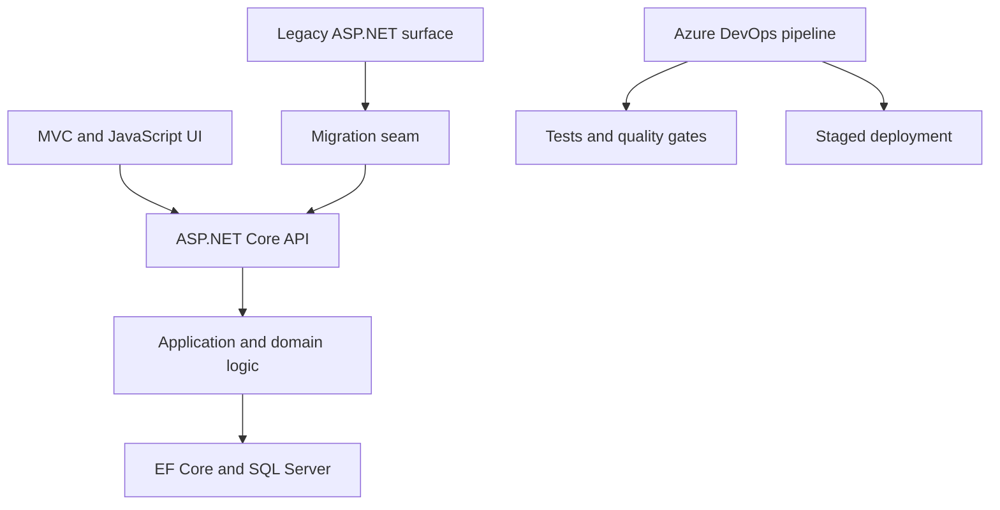
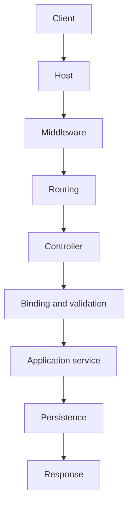
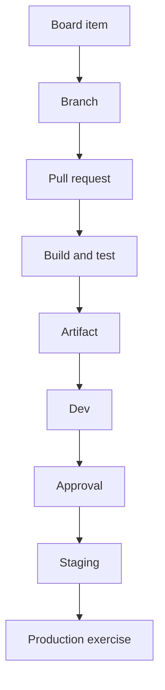

# The Gauntlet IV — Microsoft Enterprise Developer

**Modules M60–M71**  
**Target role:** Senior Developer in a Microsoft-heavy enterprise environment  
**Primary stack:** C#, .NET 10, ASP.NET Core MVC/Web API, Entity Framework Core, SQL Server, automated testing, Azure DevOps  
**Brownfield literacy:** ASP.NET Framework, VB.NET, jQuery, Knockout.js, AngularJS, JSON/XML

> The goal is not to become a junior .NET developer from scratch. It is to translate existing senior Java/enterprise engineering experience into Microsoft vocabulary and tooling, build enough with your own hands to reason rather than bluff, and become credible in both modern and brownfield .NET systems.

As of September 2026, .NET 10 is the active LTS release. Use it for new work while deliberately studying the older Microsoft estate implied by the job description. The role lists modern responsibilities beside ASP.NET, VB.NET, jQuery, Knockout, AngularJS, SQL Server, and XML; that is a modernization environment, not a greenfield-framework trivia contest.

---

## Read the role correctly

The company is not merely asking, “Can this person write C#?” It is asking whether you can:

- guide a medium-sized initiative without constant architectural supervision;
- understand an existing Microsoft application estate;
- design and deliver features across web, mobile, and internal systems;
- improve code without destabilizing production;
- mentor developers and raise code quality;
- reason about reuse without building an abstraction empire;
- communicate tradeoffs to developers, business leaders, and IT leadership;
- use Azure DevOps as part of the engineering system, not as a decorative pipeline screen.

Your risk is not that you lack all relevant experience. Your risk is that the interviewer hears “test automation pivot” and concludes that you no longer want to own application code. The whole gauntlet should demonstrate the opposite:

> Test automation was not an exit from software development. It broadened how I build software: I can design a feature, implement it, define its test seams, deliver it through CI/CD, and diagnose it in production. I am now translating that full-lifecycle experience into the .NET ecosystem.

Do not pretend the .NET gap is imaginary. Make it bounded and observable:

> My strongest production background is Java/Spring and TypeScript, so C# and the Microsoft application stack are the ecosystem gap I have been closing. The underlying work—OOP, web request lifecycles, database design, automated testing, CI/CD, modernization, and team delivery—is familiar. Here is the .NET system I built, the tradeoffs I made, and where the platforms differ.

---

## One capstone, not twelve disconnected demos

All modules feed one project: **Service Operations Hub**.

It manages service requests or work orders for an organization:

- staff submit requests;
- dispatchers prioritize and assign work;
- technicians update status and notes;
- supervisors see queues, aging, and SLA risk;
- a legacy internal page still performs one workflow;
- a modern ASP.NET Core application gradually takes ownership;
- data lives in SQL Server;
- builds, tests, artifacts, and deployments flow through Azure DevOps.

The domain is ordinary on purpose. Seniority should appear in the boundaries, failure handling, migration decisions, tests, delivery path, documentation, and team practices—not in an exotic product idea.

### Architecture target

Start as a modular monolith. A senior engineer does not earn extra credit for inventing distributed-systems problems before the domain requires them.

---

# M60 — Stop Writing Java in C#

**C# · .NET runtime · language translation · Medium · ~3 protected blocks**

## Story

You join a C# team Monday morning. Nobody needs you to relearn loops, inheritance, or interfaces. They need you to stop mentally transliterating Java and begin recognizing idiomatic C#.

Implement the domain engine without a web framework:

**work orders → technicians → assignments → status transitions → calculated priority**

## Concept translation

| You already know | Learn the .NET expression |
|---|---|
| JVM | CLR |
| Java bytecode | CIL/IL |
| JAR/dependency ecosystem | assemblies and NuGet |
| POJO | C# class or record |
| Stream API | LINQ |
| `CompletableFuture` | `Task` and `async`/`await` |
| try-with-resources | `using` and `IDisposable` |
| Spring dependency injection | built-in .NET dependency injection |
| annotations | attributes |
| getters/setters | properties |
| `Optional` and null discipline | nullable reference types |

## Trap

Writing Java with different punctuation that happens to compile as C#.

## Decisions

Before implementation, answer:

1. When should a domain type be a `class`, `record`, `record struct`, `struct`, or enum?
2. Which objects have identity and which merely represent values?
3. Where is mutability allowed?
4. What does `async` actually mean in this operation?
5. Where does LINQ improve clarity, and where would it hide work or repeated enumeration?
6. What does nullable-reference analysis prevent, and what can it not prove?

## Research targets and stops

**Object model — 25 minutes**  
Stop when you can explain record versus class versus struct without saying merely “records are shorter.”

**LINQ — 25 minutes**  
Stop when you can demonstrate deferred execution, materialization, multiple enumeration, and the difference between `IEnumerable<T>` and `IQueryable<T>`.

**Async and Task — 45 minutes**  
Stop when you can distinguish asynchronous I/O, parallel execution, threads, and Tasks. Do not study every synchronization primitive.

## Build

- immutable `WorkOrderId` and value types;
- explicit status-transition rules;
- priority calculation from age, severity, and customer impact;
- LINQ queries over in-memory collections;
- one asynchronous repository interface with cancellation support;
- nullable reference types enabled;
- unit tests for legal and illegal state changes.

## Measure

Given unfamiliar C# code, predict:

- what allocates;
- what mutates;
- what can be null;
- what executes lazily;
- what asynchronous boundary exists;
- what is disposed and when.

## Prove it in three rooms

**Interview:** “Coming from Java, these are the C# differences that changed my design rather than merely its syntax.”  
**Code review:** Identify and improve one piece of Java-shaped C#.  
**Meetup:** Explain LINQ deferred execution in 30 seconds.

---

# M61 — Follow One HTTP Request All the Way Down

**ASP.NET Core · MVC · REST · dependency injection · middleware · Large · ~4 blocks**

## Story

Build one business operation:

> A staff member submits a service request. The server binds and validates it. Business rules determine its initial state. It is persisted. A REST response is returned. An internal MVC page can display it.

One operation. Trace it completely.

## Trap

Learning ASP.NET by memorizing controller attributes.

## Runtime walk

Be able to draw and narrate:

## Decisions

1. What belongs in middleware rather than a controller?
2. What belongs in a controller rather than the domain/application layer?
3. Are request DTOs the same objects as persistence entities? Why or why not?
4. Which dependencies are singleton, scoped, or transient?
5. Where is validation structural, and where is it a business rule?
6. What status codes and error representation make the contract predictable?
7. Where should cancellation tokens flow?

## Research targets and stops

**Hosting and middleware — 35 minutes**  
Stop when you can predict the effect of middleware order and explain short-circuiting.

**Routing, binding, validation — 35 minutes**  
Stop after deliberately causing binding failure, validation failure, business-rule failure, and an unhandled exception—and observing the different responses.

**Dependency injection lifetimes — 25 minutes**  
Stop when you can explain why injecting a scoped dependency into a singleton is dangerous.

## Build

- `POST /api/work-orders`;
- `GET /api/work-orders/{id}`;
- an MVC list/detail page;
- request and response DTOs distinct from persistence entities;
- centralized problem-details responses;
- correlation ID and structured request logging;
- OpenAPI documentation;
- dependency registration kept visible and intentional.

## Measure

For one request, account for every transition from socket-facing host to database and back. No “then ASP.NET does stuff.”

## Prove it in three rooms

**Interview:** Compare ASP.NET Core's middleware/request model with Spring Boot filters, interceptors, controllers, validation, and DI.  
**Design review:** Defend why business rules do not live in the controller.  
**Incident room:** Locate whether a failure occurred in binding, domain logic, persistence, or response generation.

---

# M62 — Make SQL Server an Explicit Design Partner

**Entity Framework Core · SQL Server · schema design · transactions · concurrency · Large · ~4 blocks**

## Story

Two dispatchers open the same work order. One reassigns it while the other closes it from stale data. Your ORM does not remove the concurrency problem; it merely gives you tools to express a policy.

## Trap

Treating Entity Framework Core as a spell that converts classes into a correct database.

## Decisions

1. Which invariants belong in domain code, database constraints, or both?
2. Where should optimistic concurrency be enforced?
3. When is one `SaveChanges` call enough, and when is an explicit transaction justified?
4. Which relationships are required, optional, owned, or many-to-many?
5. What should be eagerly loaded, explicitly loaded, projected, or left untouched?
6. When should a query be no-tracking?
7. Who applies migrations, and at what point in delivery?
8. Which indexes support observed query patterns rather than imagined scale?

## Research targets and stops

**EF Core mapping and change tracking — 45 minutes**  
Stop when you can explain what the change tracker knows, why tracked entities can become stale, and when projection is preferable.

**SQL Server execution reality — 45 minutes**  
Inspect generated SQL and an execution plan. Stop when you can identify one avoidable N+1/query-shape problem and one useful index.

**Transactions and concurrency — 45 minutes**  
Stop when you can reproduce and handle an optimistic concurrency conflict.

## Build

- SQL Server in a reproducible local environment;
- EF Core mappings and migrations;
- constraints for required states and uniqueness;
- `rowversion` or another explicit concurrency token;
- paginated, filtered supervisor queue;
- projection directly into read models;
- one transaction spanning a meaningful multi-record operation;
- seed data that creates realistic query sizes and conflict cases;
- a short data dictionary.

Then implement one query with lower-level SQL or ADO.NET—not because EF is bad, but so you understand the boundary beneath it.

## Measure

Capture:

- query count for the supervisor page;
- query duration for a representative dataset;
- behavior during a concurrency conflict;
- migration from an empty database;
- rollback/recovery plan for a failed schema change.

## Prove it in three rooms

**Interview:** Explain why ORM fluency includes SQL fluency.  
**Code review:** Spot accidental client-side evaluation, over-fetching, or repeated enumeration.  
**Production review:** Explain how you would release a schema change without assuming application and database deploy atomically.

---

# M63 — Test the System, Not Your Mock Collection

**xUnit · test doubles · integration tests · contract tests · UI tests · Large · ~4 blocks**

## Story

The role that previously made interviewers wonder whether you wanted to “pivot” into test automation is now where you demonstrate fuller engineering ownership.

Testing is not a separate identity. It is how you prove the application you designed behaves under change.

## Trap

Producing a beautiful coverage percentage over tests that verify mock interactions and never exercise routing, serialization, SQL Server behavior, or browser workflows.

## Decisions

1. Which behavior is cheapest to prove as a unit test?
2. Which risks require the real ASP.NET host?
3. Which database behaviors require a real SQL Server-compatible environment?
4. Where is a fake appropriate, and where does mocking erase the thing being tested?
5. Which external boundary deserves a contract test?
6. What belongs in UI automation, and what becomes brittle there?
7. What is the team's response to a flaky test?

## Build

- xUnit domain tests;
- API integration tests using the real ASP.NET Core application host;
- database integration tests against a disposable database environment;
- one consumer/provider contract around a fake notification service;
- a small Playwright or Selenium smoke suite for the highest-value workflow;
- test data builders/fixtures that reveal intent;
- failure output published by the pipeline;
- mutation or fault injection against one important rule.

## Research stop

Stop comparing mocking frameworks after you can create, configure, and verify the one test double the project actually needs. Framework trivia is not the objective.

## Measure

For every test suite, state:

- what risk it covers;
- which real components it exercises;
- what defect it would miss;
- how long it takes;
- who owns a failure.

The key number is not maximum coverage. It is whether a change to a state-transition rule, HTTP contract, or SQL constraint fails in the most informative layer.

## Prove it in three rooms

**Interview:** “My test automation experience makes me better at application design because I recognize seams, contracts, failure modes, and delivery risk. I still own implementation.”  
**Code review:** Replace an implementation-coupled test with a behavior-focused test.  
**Pipeline incident:** Triage a failure as product regression, test defect, environmental failure, or intermittent system behavior.

---

# M64 — Read the Brownfield Microsoft Estate

**.NET Framework · ASP.NET MVC/Web Forms awareness · VB.NET · jQuery · Knockout.js · AngularJS · XML · Large · ~4 blocks**

## Story

You inherit an internal application that still works and makes money. Some pages use server-rendered ASP.NET, some use jQuery, one uses Knockout, another uses AngularJS, and part of the business layer is VB.NET. An XML integration predates the current team.

Your task is not to sneer at it. Your task is to map it, make a safe change, and propose a credible migration seam.

## Trap

Calling the old system “legacy” as though that alone proves it should be rewritten.

## First artifact: the estate map

| Concern | Existing implementation | Risk | Test seam | Candidate future home |
|---|---|---|---|---|
| Request/route | ASP.NET Framework |  |  | ASP.NET Core |
| View behavior | jQuery/Knockout/AngularJS |  |  | server view or chosen modern client |
| Business rule | C# or VB.NET library |  |  | portable domain/application library |
| Data access | ADO.NET/older ORM/stored procedure |  |  | retained or EF Core behind boundary |
| Integration | XML |  |  | versioned adapter/contract |

## Decisions

1. What is .NET Framework-specific versus portable business logic?
2. What uses `System.Web`, session, global state, or framework-specific authentication?
3. Can a library multi-target, be isolated behind an interface, or be left alone?
4. Is the safest first change in place, behind an adapter, or in a new route?
5. What protects the XML contract from “cleanup” that breaks a consumer?
6. Which UI framework owns each piece of DOM state?
7. What evidence would justify rewrite rather than incremental migration?

## Build

Create a deliberately small legacy companion:

- one .NET Framework-style or carefully simulated legacy workflow;
- one VB.NET business-rule library that you can call and test;
- one jQuery or Knockout screen;
- one XML import/export contract with XSD or explicit validation rules;
- characterization tests before changing behavior;
- a dependency and runtime inventory;
- an architecture decision record choosing what to leave, wrap, extract, or replace.

Do not spend weeks becoming an AngularJS or Knockout specialist. Learn enough to trace state, events, bindings, network calls, and teardown.

## Measure

Make one behavior change while preserving:

- route compatibility;
- payload or XML contract compatibility;
- existing test behavior;
- rollback capability;
- a written explanation of blast radius.

## Prove it in three rooms

**Interview:** Explain how Java/C++ modernization work prepared you to work respectfully inside an older Microsoft estate.  
**Design review:** Defend one component you chose not to rewrite.  
**Mentoring:** Show a junior developer how to trace data through a page with several generations of JavaScript without guessing.

---

# M65 — Modernize by Seams, Not by Hope

**incremental migration · strangler pattern · compatibility · feature flags · Large · ~4 blocks**

## Story

The team cannot stop feature delivery for a year-long rewrite. Move one workflow from the legacy application into ASP.NET Core while both remain operable.

Microsoft's migration guidance describes ASP.NET Framework-to-Core migration as nontrivial for most production applications and identifies incremental migration as the safer path for many large or dependency-heavy systems.

## Trap

Building a pristine replacement that cannot be released until it has reproduced ten years of accumulated behavior.

## Decisions

1. Where is the first stable seam: route, service, database access, event, or shared library?
2. Do old and new applications share a database temporarily? If so, what rules control ownership?
3. How are authentication, session, errors, logging, and configuration made coherent?
4. How do you compare new behavior with old behavior?
5. What is the rollback path?
6. When is a compatibility adapter temporary, and how will the team know it can be removed?

## Build

- select one bounded workflow from M64;
- characterize current behavior;
- route that workflow to the modern application through a visible seam;
- preserve the outward contract;
- use a feature flag or controlled routing decision;
- add comparison telemetry or shadow evaluation where safe;
- document rollback;
- delete or disable the old path only after proof.

## Measure

Maintain a migration ledger:

| Capability | Current owner | Future owner | Compatibility layer | Exit evidence |
|---|---|---|---|---|

No item is “migrated” merely because new code exists. It is migrated when traffic, ownership, operations, and rollback responsibility are clear.

## Prove it in three rooms

**Interview:** Contrast rewrite, in-place upgrade, and incremental migration.  
**Leadership review:** Explain the delivery/risk tradeoff in business language.  
**Incident room:** Roll traffic back without improvising.

---

# M66 — Make Azure DevOps the Delivery System

**Azure Repos · Boards · YAML Pipelines · artifacts · environments · quality gates · Large · ~4 blocks**

## Story

The application works locally. That is the beginning of the delivery problem, not the end.

Build a delivery path that another developer can understand and operate: work item to branch to pull request to test evidence to artifact to environment.

## Trap

Copying a giant YAML file until green checks appear without understanding agents, stages, jobs, tasks, variables, artifacts, environments, or permissions.

## Runtime walk

## Decisions

1. What runs on pull request, merge, scheduled execution, or manual invocation?
2. Which stages consume the same immutable artifact?
3. Which values are configuration, secrets, or compile-time inputs?
4. When is a Microsoft-hosted agent enough, and when is a self-hosted agent justified?
5. Which approvals/checks belong to an environment rather than YAML?
6. How are database migrations promoted and observed?
7. What evidence blocks a merge or deployment?
8. Who can change the pipeline and service connection?

## Build

- Azure Boards epic/feature/story/bug structure for the capstone;
- Azure Repos or a connected Git repository;
- branch policies and pull-request template;
- multi-stage YAML pipeline;
- restore, compile, static analysis, unit tests, integration tests, coverage, and artifact publication;
- deployment to at least two named environments;
- secret retrieval through an appropriate protected mechanism;
- migration step with explicit failure behavior;
- test and coverage results visible from the run;
- a release note generated from traceable work items or commits;
- one intentionally failed deployment and practiced recovery.

## Measure

From a clean commit, can another engineer answer:

- what changed;
- what tests ran;
- which artifact was produced;
- who approved promotion;
- which configuration was used;
- whether the schema changed;
- how to redeploy or roll back?

## Prove it in three rooms

**Interview:** Translate Jenkins/Spinnaker experience into Azure Pipelines concepts without claiming the tools are identical.  
**Design review:** Defend where the quality gates live.  
**Operations:** Diagnose a failure by stage rather than rerunning blindly.

---

# M67 — Design for Change Without Building a Framework

**system design · refactoring · code reuse · modularity · architecture decisions · Large · ~4 blocks**

## Story

The team has three request types with similar workflows. Someone proposes a universal workflow engine. Someone else copies the controller and changes six lines. You need a third answer grounded in the actual variation.

## Trap

Treating “code reuse” as maximum deduplication.

## Decisions

1. Is duplication accidental, temporary, or evidence of a stable abstraction?
2. Which rules belong to a shared domain concept, and which only look similar today?
3. Is the module boundary enforced in code and dependencies or only shown on a diagram?
4. When should you use inheritance, composition, strategy, policy objects, generics, or plain duplication?
5. What refactoring can be safely included with the feature, and what needs a separate phase?
6. What decision requires an ADR?
7. What would make a service extraction worthwhile later?

## Build

- a dependency map of the capstone;
- explicit modules for intake, dispatch, work execution, and reporting;
- architecture tests or dependency checks preventing forbidden coupling;
- one refactoring performed under characterization/integration tests;
- one rejected abstraction documented with evidence;
- an ADR for modular monolith versus services;
- an ADR for DTO/domain/persistence separation;
- a refactoring proposal divided into safe phases.

## Measure

Add a second work-order type. Count how many modules must change and explain why. The goal is not zero changed files; the goal is changes that follow the domain boundary rather than scatter unpredictably.

## Prove it in three rooms

**Interview:** Describe a time you recommended phased refactoring rather than a rewrite.  
**Code review:** Explain when duplication is safer than premature reuse.  
**Architecture review:** Identify the first pressure that would justify splitting the modular monolith.

---

# M68 — Operate the Application You Built

**security · observability · performance · reliability · incidents · Large · ~4 blocks**

## Story

A supervisor reports that queues became slow after a release. At the same time, an authorization review discovers that technicians may be able to request another team's work-order details by ID.

You need evidence, not framework faith.

## Trap

Calling middleware, authentication, logging, and health checks “production-ready” because the packages are installed.

## Decisions

1. What is authenticated, and what is authorized at resource level?
2. What information may enter logs?
3. Which health checks indicate process life versus readiness to serve traffic?
4. What latency/error signals matter to users?
5. Where do retries help, and where could they duplicate an operation?
6. What requires idempotency?
7. What performance claim has measured evidence?

## Build

- role and resource-level authorization tests;
- safe configuration and secret handling;
- input/output and mass-assignment review;
- structured logs with correlation across request and persistence work;
- health/readiness endpoints;
- metrics for latency, errors, queue age, and failed transitions;
- tracing around one slow request path;
- a load test at realistic capstone scale;
- a runbook for slow requests and failed deployments;
- one blameless incident review from an intentionally introduced defect.

## Measure

Start with a symptom, locate evidence, identify the failing layer, mitigate, verify recovery, and propose prevention. Do not debug by adding random log statements until the problem disappears.

## Prove it in three rooms

**Interview:** Walk through one production-style diagnosis.  
**Security review:** Demonstrate that changing an ID cannot bypass ownership/team authorization.  
**Leadership review:** Explain technical risk, user impact, mitigation, and follow-up without drowning the room in stack details.

---

# M69 — Lead the Team, Not Just the Code

**initiative leadership · mentoring · conflict · accountability · communication · Medium · ~3 blocks**

## Story

One developer wants a rewrite. Another wants to keep patching the old module. A third is blocked but has hidden it for two days. Product needs a date. Architecture is available only for a short review.

Your deliverable is a decision and a working team—not a heroic solo commit.

## Trap

Performing “seniority” as certainty, domination, or having an answer faster than everyone else.

## Practices to rehearse

- convert an ambiguous outcome into milestones, risks, owners, and decision points;
- create a lightweight technical plan that invites correction;
- distinguish reversible and irreversible decisions;
- surface blocked work early without humiliating the developer;
- make code-review feedback specific, prioritized, and teachable;
- disagree using evidence and constraints;
- delegate a real outcome rather than a list of keystrokes;
- give business and technical stakeholders different levels of detail without changing the truth;
- run a short retrospective that produces one owned improvement.

## Artifacts

- one-page initiative brief;
- risk/assumption/decision/dependency log;
- code-review rubric;
- mentoring plan for a developer learning async/database work;
- written response to a design disagreement;
- status update for business leadership;
- technical update for engineering leadership;
- post-incident action list with owners and dates.

## Measure

After reading your plan, can another developer tell:

- what outcome matters;
- what they own;
- where they can decide independently;
- what could derail the work;
- when to escalate;
- what “done” means?

## Prove it in three rooms

**Interview:** Use STAR stories where leadership changed the team's outcome, not merely your own output.  
**Conflict:** Restate both positions accurately before proposing a decision rule.  
**Mentoring:** Ask the learner to predict and explain before supplying the answer.

---

# M70 — Capstone: Ship the Service Operations Hub

**full-stack .NET · SQL Server · brownfield migration · testing · Azure DevOps · XL · ~8–12 blocks**

## Required capabilities

### Modern surface

- ASP.NET Core MVC internal interface;
- versioned REST endpoints;
- C# domain/application logic;
- EF Core and SQL Server;
- validation and predictable problem responses;
- assignment, status transitions, notes, and supervisor queue;
- authentication stub or real development-safe identity integration;
- resource-level authorization.

### Brownfield surface

- one legacy-style page or service;
- at least one VB.NET component you can trace and test;
- one jQuery, Knockout, or AngularJS interaction;
- one XML contract;
- characterization tests;
- documented incremental migration seam.

### Delivery and operations

- Azure Boards work breakdown;
- pull-request policy and code review;
- Azure Pipelines YAML;
- unit, integration, database, contract, and minimal UI tests;
- immutable artifact promotion;
- development and staging environments;
- protected secrets/configuration;
- logs, metrics, health checks, and runbook;
- database migration and rollback plan.

## Mandatory decision records

1. Why .NET 10 for new work?
2. Why modular monolith rather than microservices?
3. Why DTOs, domain types, and persistence entities are or are not separated?
4. What “private/internal” authorization means in the application?
5. Why a particular legacy workflow is migrated first?
6. How data ownership works while legacy and modern surfaces coexist?
7. What quality gates block merge and deployment?
8. What you deliberately did not build?

## Demonstration script

1. Open the Board item that defines the feature.
2. Show the pull request and explain one review decision.
3. Submit a work order through the UI.
4. Trace the request through middleware, controller, application rule, EF Core, and SQL Server.
5. Trigger a validation failure and show the contract.
6. Reproduce an optimistic concurrency conflict.
7. Run the automated suites and locate the evidence in Azure DevOps.
8. Show the legacy workflow and the seam routing one capability to the modern application.
9. Deploy the same artifact through staged environments.
10. Introduce or replay an operational failure and use telemetry/runbook evidence to diagnose it.
11. Show the phased modernization ledger.
12. Close with what you would do next if this were a real team system.

## The seniority test

The project is not complete because CRUD works. It is complete when you can explain:

- why the architecture fits the current scale;
- which risks drove the tests;
- how two developers could work in it without colliding constantly;
- how a release is traced and recovered;
- how old and new code coexist;
- what evidence would make you change the design;
- how you would mentor someone through the hardest part.

---

# M71 — Become Conversational Without Bluffing

**interview compression · system narration · leadership stories · Medium · ~3 blocks**

## Story

You have built the project. Now convert it into answers short enough for an interview and deep enough to survive follow-up questions.

## The six conversations

Prepare a 30-second, 2-minute, and deep-dive version of each:

1. **Java/Spring to C#/.NET:** similarities, differences, and one design consequence.
2. **ASP.NET request lifecycle:** middleware to response.
3. **EF Core and SQL Server:** tracking, query shape, transactions, concurrency, migrations.
4. **Testing as development ownership:** risk-based test layers and delivery evidence.
5. **Brownfield modernization:** characterize, isolate, route, compare, migrate, retire.
6. **Technical leadership:** scope, decisions, delegation, conflict, mentoring, and communication.

## Vocabulary checkpoint

Be able to use these accurately, not merely recognize them:

`CLR` · `assembly` · `NuGet` · `record` · nullable reference types · `Task` · cancellation token · LINQ · deferred execution · `IEnumerable` · `IQueryable` · middleware · model binding · DI lifetime · options/configuration · hosted service · `DbContext` · change tracking · migration · concurrency token · problem details · xUnit · integration host · Azure agent · stage · job · task · artifact · environment · service connection · branch policy

## Do not bluff list

Say plainly when:

- you have built with ASP.NET Core but not operated a large .NET production estate;
- your VB.NET/Knockout/AngularJS work is deliberate brownfield literacy rather than years of specialization;
- you understand an Azure DevOps concept through adjacent Jenkins/Spinnaker experience but have less production tenure with the Microsoft tool;
- a design choice was made for the capstone scale and would be revisited under different evidence.

Specificity sounds more senior than inflated certainty.

## Reframe the earlier interview concern

Do not defensively insist that you “were always full stack.” Show continuity:

> I began in full-stack application development and then spent substantial time on test automation and delivery quality inside a production engineering organization. That work did not move me away from development; it strengthened how I design code for testability, reason about system boundaries, and own change through CI/CD. I am pursuing this role because I want that full lifecycle—feature design, implementation, quality, modernization, and team leadership. The .NET project I built is evidence of that direction, not just a claim about it.

Then invite the technical follow-up.

---

# Research fence

For this interview campaign, do **not** disappear into:

- every C# language feature;
- Blazor unless the company confirms it matters;
- .NET MAUI unless the mobile estate specifically uses it;
- microservices, Kubernetes, or event sourcing for their own sake;
- every Azure service;
- Dynamics, Power Platform, or Microsoft 365 without role evidence;
- mastering AngularJS or Knockout as if they were greenfield choices;
- rewriting the capstone frontend repeatedly;
- advanced CLR internals before you can trace one request;
- custom identity infrastructure;
- maximum test coverage;
- certification study as a substitute for a working system.

Hard stops:

> If I am comparing .NET web frameworks before one request reaches SQL Server, I have left the module.

> If I am designing microservices before the modular monolith has a real coupling problem, I have left the module.

> If I am polishing the UI while the pipeline cannot reproduce the build, I have left the module.

> If I am mocking EF Core instead of testing the database behavior I care about, I have left the module.

> If I am learning all of VB.NET before I can trace and safely change one component, I have left the module.

> If I am describing myself as “basically already a .NET senior” instead of demonstrating precise transferable seniority and honest ecosystem growth, I have left the campaign.

---

# Fast campaign order

If the referral/interview is close, do not complete the modules strictly in numeric order.

## First 3 days — become legible

1. M60: C# translation
2. M61: one request end-to-end
3. M62: persistence and one concurrency conflict

**Output:** a runnable vertical slice and a diagram you can explain.

## Days 4–6 — make your background an advantage

1. M63: layered automated tests
2. M66: Azure DevOps pipeline
3. rehearse the test-automation-to-full-lifecycle explanation from M71

**Output:** evidence that testing and delivery strengthen your developer candidacy.

## Days 7–9 — address the actual estate

1. M64: brownfield map and small legacy component
2. M65: one incremental migration seam
3. M67: phased refactoring and reuse decisions

**Output:** a credible answer to why this stack contains both ASP.NET/VB.NET and modern C#.

## Days 10–12 — sound senior

1. M68: observability/security/incident exercise
2. M69: leadership artifacts and stories
3. M70/M71: capstone demonstration and interview compression

**Output:** a 10-minute demonstration, six deep-dive stories, and three leadership examples.

If you have less than a week, prioritize M60, M61, M62, M63, the pipeline core of M66, and the conversational work in M71. Read M64/M65 deeply enough to discuss brownfield tradeoffs, but do not fake years of VB.NET or Knockout experience.

---

# Definition of interview readiness

You are ready when you can do all of the following without notes:

- trace an ASP.NET Core request into SQL Server and back;
- compare the path with Java/Spring precisely;
- explain C# records/classes, nullable reference types, LINQ execution, and async/Task behavior;
- show an actual EF Core concurrency conflict and resolution policy;
- explain why each test layer exists;
- navigate an Azure DevOps pipeline from commit to promoted artifact;
- inspect a small VB.NET or older JavaScript component without contempt or panic;
- propose an incremental migration seam and rollback path;
- explain one abstraction you rejected;
- give examples of mentoring, conflict resolution, phased refactoring, and technical communication;
- state the limits of your .NET experience honestly while showing the system you built.

The target sentence is not:

> “I have touched every technology in the job description.”

It is:

> “I have the enterprise engineering and leadership foundation this role needs; I have now built enough of the Microsoft stack to reason concretely about its runtime, data, testing, brownfield, and delivery concerns; and I can show you exactly how I would continue closing the ecosystem gap.”

---

# Official source shelf

Use primary documentation and stop when the module's proof condition is met.

- [.NET support policy](https://dotnet.microsoft.com/en-us/platform/support/policy/dotnet-core)
- [C# documentation](https://learn.microsoft.com/en-us/dotnet/csharp/)
- [Asynchronous programming with async and await](https://learn.microsoft.com/en-us/dotnet/csharp/asynchronous-programming/)
- [LINQ documentation](https://learn.microsoft.com/en-us/dotnet/csharp/linq/)
- [ASP.NET Core fundamentals](https://learn.microsoft.com/en-us/aspnet/core/fundamentals/)
- [ASP.NET Core middleware](https://learn.microsoft.com/en-us/aspnet/core/fundamentals/middleware/)
- [ASP.NET Core integration tests](https://learn.microsoft.com/en-us/aspnet/core/test/integration-tests/)
- [EF Core documentation](https://learn.microsoft.com/en-us/ef/core/)
- [EF Core SQL Server provider](https://learn.microsoft.com/en-us/ef/core/providers/sql-server/)
- [EF Core concurrency handling](https://learn.microsoft.com/en-us/ef/core/saving/concurrency)
- [Migrate from ASP.NET Framework to ASP.NET Core](https://learn.microsoft.com/en-us/aspnet/core/migration/fx-to-core/)
- [Visual Basic documentation](https://learn.microsoft.com/en-us/dotnet/visual-basic/)
- [Azure DevOps documentation](https://learn.microsoft.com/en-us/azure/devops/)
- [Azure Pipelines documentation](https://learn.microsoft.com/en-us/azure/devops/pipelines/)
- [Azure Pipelines YAML schema](https://learn.microsoft.com/en-us/azure/devops/pipelines/yaml-schema/)
- [Azure Repos branch policies](https://learn.microsoft.com/en-us/azure/devops/repos/git/branch-policies)
- [Azure Test Plans documentation](https://learn.microsoft.com/en-us/azure/devops/test/)

---

# Final rule

Do not try to win by claiming the gap does not exist.

Win by showing that the gap is **specific, bounded, actively shrinking, and sitting on top of a much larger body of directly transferable senior engineering experience**.
